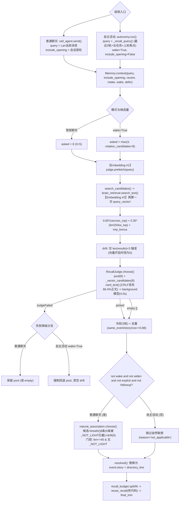

# P6-1｜检索、判官与自然联想专项审计报告（修订版）

> **审计性质**：只读专项审计（未修改任何正式功能代码、记忆数据或运行配置；未启动施工或付费实验；隔离复现均在临时副本 `brain_copy.db` 上完成）。
> **审计基准**：
> - 仓库 `origin/main` 最新提交：`2408bb6`（`Add read-only model configuration overview and desktop regression coverage (#448)`）
> - 正式运行目录 `<formal-runtime-dir>` 当前 `HEAD`：`160b0ec`（`P3-4：同步维护窗口清理兼容修复 (#447)`，工作区仅含 P3-4 验收同步的 `STATUS.md` / `HANDOFF.md` 本地修改；`160b0ec` 与 `2408bb6` 在检索、判官、自然联想相关模块上代码完全一致）。

---

## 一、核心结论摘要与三类结论分层

为避免将“已证实的代码缺陷”“运行观测现象”与“待验证的优化假设”混为一谈，本报告将全部发现严格分为三层：

### 1.1 已复现的确定性缺陷（代码 + 隔离副本直接复现）
1. **判官卡片 CRLF 换行导致 68.4% 记忆正文丢失**：[recall_judge.py#L76](../../recall_judge.py#L76) `card_text()` 硬编码 `raw.partition('\n---\n')`，而 `brain.db` 中 **154/225（68.4%）** 可见记忆的 `raw_markdown` 使用 `\r\n---\r\n`。隔离复现实验表明，这 154 条记忆的 `opening / ending / keywords` 全部为空，平均卡片长度从 `289.5` 字跌至 `116.5` 字。
2. **同轮重复调用 Embedding API**：[memory_agent.py#L1517-L1523](../../memory_agent.py#L1517-L1523) 中 `judge.prefetch(query)` 与 `search_candidates(query)` 对同一 `query` 各自独立调用 `QueryEmbedder.embed(query)`，造成双倍 API 消耗与额外延迟。
3. **`brain_retrieval.drift` 触发条件在向量开启时恒不成立**：[brain_retrieval.py#L241](../../brain_retrieval.py#L241) 仅在 `len(results) < 3` 时触发随机 `drift`。隔离复现（20 组向量查询）`len(results) < 3` 出现 **0/20** 次，与生产环境 `drift_nonempty = 0/73` 完全一致。
4. **自然联想实际候选池枯竭至全库 1.3%（3/225 条）**：[memory_agent.py#L1508](../../memory_agent.py#L1508) 将 `self.opening`（`brain_authority.breath()` 按 `pinned DESC, importance DESC, created DESC LIMIT 8`）作为联想池；隔离检查显示这 8 条中有 **5 条**因正文前 600 字含 `_NOT_LIGHT` 工作词被永久拦截，全库仅剩 **3 条**可触发自然联想。
5. **`breath_search` 主动检索忽略日期参数与配置文件权重**：[memory_native.py#L1376-L1380](../../memory_native.py#L1376-L1380) 传入了 `date_from / date_to`，但 [brain_authority.py#L206-L211](../../brain_authority.py#L206-L211) `breath_search(query, limit, embedder)` 不接收日期参数且硬编码 `0.65 / 0.35` 权重。
6. **`reuse_recall()` 为永不生效的死代码**：[memory_agent.py#L1968-L1998](../../memory_agent.py#L1968-L1998) 在 `history`（仅含 `user/assistant` 消息）中搜索注入在 `system` 消息里的记忆正文，实证命中 **0/220**。
7. **自主活动完全关闭自然联想**：[memory_agent.py#L1684](../../memory_agent.py#L1684) `if not wake and not widen and not explicit and not followup:` 导致自主活动（`wake=True`）时 `natural_association` 恒为 `not_applicable`。

### 1.2 运行数据支持的问题（生产日志实证）
1. **判官失败率统一口径（历史总体 vs Brain 时代）**：按 Brain 检索切换时间点（`2026-11-24T00:54:43+08:00`）切分后，两份独立日志口径完全对齐——Brain 时代判官技术失败率已从 Ombre 时代的 **17.0%–21.0%** 降至 **6.8%–6.9%**，但 Brain 时代剩余的 5 次失败 **100% 为 `timeout:model`**（`timeout_seconds=4.0`）。
2. **混合检索 Top-8 漏掉近半判官命中**：Brain 时代判官最终选中的 84 条记忆中，**41 条（48.8%）** 不在 `brain_retrieval` 的混合 Top-8 中，全靠判官 `_vector_candidates` 补充的 Top-8 纯向量候选捞回。
3. **检索延迟高**：Brain 时代 `retrieval elapsed_ms` 中位数 **1984 ms**，最大 **12407 ms**。
4. **事件故事与 `related_to` 未参与检索/扩展**：`brain.db` 中 76 个事件均有完整 `story`，`relations` 表中 84/120（70%）为 `related_to`，均未被 `brain_retrieval` 索引或图谱扩展使用。

### 1.3 尚待实验验证的优化假设（不可未测先改）
1. **RRF + 中文停用词过滤**是否能显著提升混合检索 Recall@8 并降低噪声挤占（需消融实验验证）。
2. **放宽判官提示词**（允许情感/关系共情场景）是否会以“误召回/生硬硬扯”为代价换取召回率（需对照实验定量权衡）。
3. **自然联想引入轻语义/情感匹配及扩大候选池**后，是否能在不增加违和感的前提下提升无关键词闲聊的自然度。
4. **事件 `story` 入索引 + `related_to` 一跳扩展**对跨事件召回的实际增益与 Token 预算开销。

---

## 二、统计口径统一：历史总体 vs Ombre 时代 vs Brain 时代

为消除此前报告中“将 `diagnostics.jsonl` 全量 18.8% 失败率直接归因于当前系统”的口径混淆，现以 Brain 检索正式切换时间戳 `2026-11-24T00:54:43+08:00` 为界，对齐两份生产日志：

| 数据源与切分口径 | 样本数 `N` | `chosen / ok` | `empty` | `failed`（失败率） | `skipped` | 失败原因分布 |
|---|---:|---:|---:|---:|---:|---|
| `recall-diagnostics.jsonl` **历史全量** | 220 | 79 (35.9%) | 109 (49.5%) | **30 (13.6%)** | 2 (0.9%) | — |
| `recall-diagnostics.jsonl` **Ombre 时代** (`< 11-24 00:54`) | 147 | 47 (32.0%) | 73 (49.7%) | **25 (17.0%)** | 2 (1.4%) | — |
| `recall-diagnostics.jsonl` **Brain 时代** (`>= 11-24 00:54`) | **73** | **32 (43.8%)** | **36 (49.3%)** | **5 (6.8%)** | 0 | — |
| `memory/_agent/diagnostics.jsonl` **历史全量** | 467 | 160 (34.3%) | 219 (46.9%) | **88 (18.8%)** | — | model超时75, embed超时9, 其他4 |
| `memory/_agent/diagnostics.jsonl` **Brain 切换前** | 395 | 129 (32.7%) | 183 (46.3%) | **83 (21.0%)** | — | model超时70, embed超时9, 其他4 |
| `memory/_agent/diagnostics.jsonl` **Brain 时代** | **72** | **31 (43.1%)** | **36 (50.0%)** | **5 (6.9%)** | — | **100% 为 `timeout:model` (5/5)** |

**结论**：
- Brain 检索上线后，判官选中率由 **32.0% 提升至 43.8%**，失败率由 **17.0%–21.0% 降至 6.8%–6.9%**（两份日志高度一致）。
- 当前 Brain 时代的 **6.8%–6.9%** 失败全部源于模型侧 `timeout:model`（4.0s 硬超时），Embedding 超时已清零。

---

## 三、完整检索、判官与自然联想链路图（含普通聊天 vs 自主活动）

---

## 四、真实聊天场景四象限复现与独立相关性金标准

### 4.1 真实聊天场景四象限分析（来自 `recall-diagnostics.jsonl` + `chat.jsonl`）

Brain 时代空召回率为 **49.3%（36/73）**，但**空召回率 ≠ 过度保守**。通过将 `query_hash` 与 `chat.jsonl` 真实消息对齐，真实场景明确分为以下四类：

| 象限分类 | 真实聊天场景示例（Brain 时代实测） | 系统实际行为 | 归因定位 |
|---|---|---|---|
| **1. 合理空召回** | • `<短英文感叹>`（`01:01:39`） • `"[表情包：邪恶比格/威胁]"` 等 3 次纯表情包 • `<日常短促回应>`（`01:53:23`） • `<日常英文亲昵应答>`（`06:04:11`） | `judge = empty`（`relevant_recall = []`） | **判官判断正确**。此类纯口语/表情包/短应答本就不应强行注入“相关记忆”。 |
| **2. 错误空召回（漏召回）** | • `<情绪抱怨 CI 重试等待>`（`01:59:36` `empty`，15秒后重试 `01:59:51` 却选中 `<记忆条目 A>`） • `<短追问消息去向>`（`08:42:24` `empty`，而 `08:38:01` 选中 `<记忆条目 B>`） • `<明确追问早期记忆版本与颜色细节>`（`05:18:54` 漏掉 `<记忆条目 C>`） | 同一语义/明确追问出现漏选或结果抖动 | ① CRLF 截断使 68.4% 记忆卡片失去正文；② 混合检索 Top-8 挤占；③ 判官 Prompt 过于保守 + 随机字母顺序抖动。 |
| **3. 合理召回** | • `<明确提及共同玩笑关键词>` → 命中 `<记忆条目 D>`、`<记忆条目 C>` • `<分享刚睡醒状态>` → 命中 `<记忆条目 E>` 等 4 条 • `<明确指代并补充既有事件>` → 命中 `<记忆条目 F>` | `judge = chosen` 且命中精准 | 向量检索 + `_vector_candidates` 补充 + `resolved()` 事件故事替换协同生效。 |
| **4. 误召回 / 生硬联想** | • `<极短模糊英文词>`（`01:11:32`）→ 判官选中 `<记忆条目 G>`，且自然联想硬插 `<记忆条目 H>` • `<极短语气词>`（`23:36:04`）→ 判官超时失败 + 自然联想硬插 `<记忆条目 I>` | 极短模糊语触发弱相关历史或无语义联想 | ① 判官对极短词缺乏上下文时过拟合标题；② `natural_association` 无语义匹配，仅按 `importance*10+silence` 从 3 条里轮转。 |

### 4.2 独立场景相关性标注集设计（替代“判官选中结果”）

为避免将现有判官（受 CRLF 截断与自身 Prompt 偏置污染）的输出当作“金标准”，后续实验应建立 **独立人工标注基准集（建议 40–50 条真实历史切片）**，按以下 5 类场景独立标注 `expected_relevant_ids` 与 `allow_empty`：

| 场景类别 | 样本特征 | 独立标注标准（Ground Truth） | 核心检验指标 |
|---|---|---|---|
| **A. 显式回忆与事件追问** | 含“还记得…/上次…/后来呢”或指代某共同经历 | 必须召回对应事件 `story` 或相关阶段记忆（`allow_empty=False`） | Recall@8, 判官正召回率 |
| **B. 隐含情境/无关键词情感闲聊** | 倾诉疲惫、睡眠、情绪、日常分享，不提记忆原标题词 | 仅当存在**直接相关经历/习惯/共同梗**时标注正例；纯情绪安慰允许空召回 | 召回率 vs 违和感人工评分 |
| **C. 跨事件人物/主题/时间关联** | 涉及同一人/物在不同时期的多条记忆，或 `related_to` 关联事件 | 应能通过事件索引或一跳关联同时触达关联记忆 | 跨事件覆盖率 |
| **D. 应空召回的日常噪声/纯指令** | 表情包、`"马上"`、`"ok love u"`、纯技术报错指令 | `expected_relevant_ids = []`（任何强行召回计为误召回） | 误召回率（False Positive Rate） |
| **E. 同词异义/高频虚词陷阱** | 含“测试/今天/那个/说好”等高频词但语义无关 | `expected_relevant_ids = []` 或仅语义匹配项，不得被 BM25 虚词命中项挤占 | 抗噪声能力 / NDCG@8 |

---

## 五、自然联想在自主活动中的实际链路与效果审计

对比普通聊天与自主活动（`autonomy`）的代码链路与 `recall-diagnostics.jsonl` 实测（含 `q_len=187~417` 的自主唤醒记录）：

| 维度 | 普通聊天 (`veil_agent.send`) | 自主活动 (`autonomy.run`) | 差异与影响 |
|---|---|---|---|
| **Query 构造** | Lan 的当前原始消息（可能只有 4–40 字） | [autonomy.py#L1084-L1100](../../autonomy.py#L1084-L1100) `_recall_query()`：拼接最近 3 条对话（各截 65 字）+ 活跃长任务 + 上轮 `focus / next_step`（限 600 字） | 自主唤醒 query 天然偏长（180–420 字）且高度结构化、偏任务态。 |
| **判官提示词与候选上限** | `memory.judge.prompt`；`ombre_candidates=8` + `vector_candidates=8` | `memory.judge.wake`；`candidate_limit=max(3, rotation_candidates=8)` + `vector_candidates=8` | `wake` 判官重点看与“当前关注/任务”直接相关的记忆，在 `08:21:58` 唤醒中成功选中 `<记忆条目 J>` 等 3 条。 |
| **自然联想 (`natural_association`)** | 仅在非 `wake/widen/explicit/followup` 时运行；但受限于 8 条 `breath()`（实际 3 条可用）与 `light_chars=40` | [memory_agent.py#L1684](../../memory_agent.py#L1684) **`if not wake and not widen...` 直接跳过**，诊断固定记 `reason='not_applicable'` | **自主活动中自然联想能力完全关闭**。醒来独自思考或闲逛时，无法由近期情绪/未竟之事自然联想到旧记忆，只能依赖 `_recall_query` 关键词/向量硬匹配。 |
| **开场记忆 (`include_opening`)** | 会话首轮 `True`（注入 `breath()` 8 条） | `opening_turn` 要求 `not autonomy`，故恒为 `False` | 自主活动不带开场记忆，若判官返回 `empty`，则记忆区完全为空。 |
| **失败降级** | `JudgeFailed` 时保留 `pool` | [memory_agent.py#L1552-L1558](../../memory_agent.py#L1552-L1558) 回退 `pool` 并强制清空 `drift=[]` | 自主活动比普通聊天更保守地屏蔽随机漂移。 |

**审计结论**：自主活动当前只有“任务导向的相关性检索（`wake` 判官）”，**完全缺失“自主闲暇时的自然联想”**。若未来希望 Peter 在自主唤醒（非执行紧急长任务时）也能自然想起某件旧事并主动发消息/写日记，需要在 `autonomy` 闲暇唤醒分支中单独设计低打扰度的自然联想通道，而非简单复用聊天版的 `light_chars=40` 门控。

---

## 六、单变量对照与消融实验设计（9 项独立验证）

基于上述独立标注基准集（Section 4.2）与 `scripts/brain_retrieval_replay.py` 离线框架，建议按“**先修确定性基线，再做单变量消融**”的顺序执行以下 9 项独立实验，量化每项改动的独立收益：

| 实验编号 | 验证变量 | 对照组 (Baseline) vs 实验组 (Treatment) | 核心观测指标 | 预期成本 |
|---|---|---|---|---|
| **E1** | **CRLF 修复** | `card_text(raw)` vs `card_text(raw.replace('\r\n','\n'))` | 卡片有效正文覆盖率（31.6% → 100%）、场景 A/B 判官正召回率变化 | 仅离线/小样本重跑判官 |
| **E2** | **Embedding 复用** | 同轮调用 2 次 Embed vs `search_candidates` 与 `judge` 共享 1 次 `query_vector` | 端到端检索耗时（预期降 ~1–2s）、Embedding API 调用量（-50%） | 零额外模型成本 |
| **E3** | **判官超时设置** | `timeout_seconds = 4.0s` vs `{5.0s, 6.0s, 8.0s}` | `timeout:model` 失败率（当前 Brain 时代 6.9%）、P95 对话首字延迟 | 零额外模型成本 |
| **E4** | **混合检索候选池大小 `K`** | `asked = 8` vs `{12, 16, 24}`（固定融合算法） | 基准集 Recall@K、判官 `_vector_candidates` 补充占比 | 零 LLM 成本（纯本地/单向量） |
| **E5** | **融合算法与停用词** | `0.65*vec/top + 0.35*bm25/top`（无停用词）vs `RRF(k=60)` vs `Pure-Vector`，分别叠加中文停用词表 | 场景 A/B/E 的 Recall@8 与 NDCG@8、闲聊噪声挤占率 | 零 LLM 成本 |
| **E6** | **判官提示词保守度** | 现行 `memory.judge.prompt` vs 放宽“情感/关系/共同经历共情”的提示词版本 | 场景 B 召回率提升幅度 vs 场景 D/E 误召回率变化 | 小样本固定集 LLM 评估 |
| **E7** | **卡片表达方式** | `CARD_CHARS=300`（头+尾）vs `500` 字（含中段关键句或所属 `event.story` 摘要） | 场景 A/C 判官命中率 vs 判官单次输入 Token 增量 | 小样本固定集 LLM 评估 |
| **E8** | **事件故事索引** | 仅索引 `memories` 表 vs 将 `events(title, story)` 纳入向量与 BM25 索引 | 长跨度事件追问（场景 A/C）的 Recall@8 提升 | 一次性为 76 条 story 算向量 |
| **E9** | **关联扩展 (`related_to`)** | 无图谱扩展 vs 命中记忆后沿 `related_to` / `EVENT_LINKS` 做一跳关联扩展进候选池 | 跨事件场景 C 覆盖率 vs 候选池膨胀与预算裁剪率 | 零额外 Embedding 成本 |

---

## 七、明确功能缺陷 vs 待验证架构优化（供 P6-4 制定施工顺序）

为方便 P6-4 全局汇总与排期，以下将“**确定性缺陷修复**”与“**需先做消融再施工的架构优化**”明确拆分为两张独立清单：

### 清单 A：明确功能缺陷（确定性 Bug，可直接排期修复，低风险高确定性）
1. **[recall_judge.py#L76](../../recall_judge.py#L76) `card_text()` CRLF 解析失效**：修复 `\r\n` 换行兼容，立即恢复 68.4%（154/225）记忆的正文与关键词卡片展示。
2. **[memory_agent.py#L1517-L1523](../../memory_agent.py#L1517-L1523) 同轮重复 Embedding 调用**：`search_candidates` 与 `judge.prefetch` 共享同一次 `query_vector` 计算结果，直接减少 50% 检索期 Embedding 调用与 ~1s+ 延迟。
3. **[memory_native.py#L1376-L1380](../../memory_native.py#L1376-L1380) → [brain_authority.py#L206-L211](../../brain_authority.py#L206-L211) `breath_search` 忽略日期过滤与配置权重**：补齐 `date_from / date_to` 过滤并读取 `[memory.retrieval]` 权重配置。
4. **[memory_agent.py#L1968-L1998](../../memory_agent.py#L1968-L1998) `reuse_recall()` 死代码**：确认是修复匹配逻辑（追踪已注入轮次）还是直接移除，消除无效遍历与误导性诊断字段。
5. **[brain_retrieval.py#L241](../../brain_retrieval.py#L241) `drift` 死条件**：`len(results) < 3` 在向量检索下永远不触发，需修正或与自然联想池解耦。

### 清单 B：需先经消融实验验证的架构优化（先跑 E3–E9 实验确认收益边界，再定施工方案）
1. **混合检索重构（E4 + E5）**：引入中文停用词表、将 Top-Only Min-Max 替换为 RRF（或调优权重与 `K` 值），解决 Top-8 漏掉 48.8% 判官命中的问题。
2. **判官超时、提示词与卡片表达调优（E3 + E6 + E7）**：在独立基准集上验证 `timeout_seconds`、情感/关系场景放宽阈值及卡片含 `event.story` 摘要的精确率/召回率平衡点。
3. **自然联想机制重构（独立设计 + 体验验收）**：脱离 `breath()` 静态 8 条限制与 5 条 `_NOT_LIGHT` 永久封锁，引入轻语义/情感相关性打分，并明确普通聊天与自主闲暇唤醒两套触发边界。
4. **事件级检索与 `related_to` 图谱扩展（E8 + E9）**：将 76 条 `events.story` 纳入向量/关键词索引，并评估 `related_to`（84 条）一跳扩展对跨事件回忆与 P7 经验注入的统一支撑能力。
