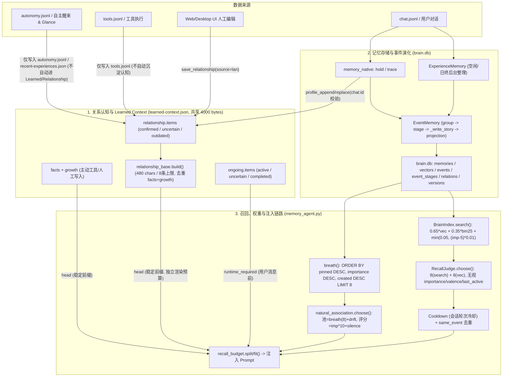

# P6-2｜关系认知、记忆权重与动态演化专项审计报告

- **审计日期**：2026-11-26
- **统一审计基准**：
  - `origin/main` 最新提交：`2408bb6f8df82b3b7d4a292ce35dde1c0faa77a1`（`#448` / `#446`，仅新增只读配置审计与模型配置概览，未改动 Brain/记忆/演化逻辑）
  - 正式运行目录（`<formal-runtime-dir>`）：`160b0ec`（P3-4 已部署；与 `2408bb6` 在记忆与认知链路代码上完全一致）
- **审计方式**：纯只读源码追踪 + 正式库/日志只读采样（`?mode=ro`）+ 隔离副本与单元测试验证；未修改任何正式功能代码、记忆数据、权重或运行配置。

---

## 一、核心结论摘要

1. **Relationship Base（关系底座）架构合理，但现实产出极少（仅 1 条且为 `uncertain`）**：
   - `relationship_base.py` 与 `learned_context.py` 实现了清晰的证据溯源降级（无有效 `chat:<message_id>` 强制降级为 `uncertain / peter`）、`outdated` 历史留存（`superseded_by`）及每轮硬预算裁剪。
   - **现实落差**：`learned-context.versions.jsonl` 全量 51 次变更中，`profile_append(relationship)` **仅发生 1 次**（`2026-11-24T09:53:03`），内容实为一条工具操作经验且 `sources=[]`（降级为 `uncertain / peter`）。原因包括：上线晚（工单 422）、`prompts/` 缺少引导提示词（Peter 习惯将关系反思继续写入 `growth`，共 23 次）、`facts + growth` 已占共享上限 `3148 / 4000` 字节，以及 `event:` / `memory:` 指针目前无法晋升为 `confirmed`。
2. **记忆权重体系高度割裂，多数字段“只存不用”**：
   - `memories` 表中 `valence`（238/241）、`arousal`（238/241）、`last_active`（239/241，且 `update_memory` 不更新）、`protected`、`anchor`、`digested`、`resolved`、`first_of_kind`、`meaning`、`triggered_by` 以及 84 条 `relations.related_to` **均未参与检索、判官或自然联想排序**。
   - 真正参与运行的权重只有 `importance`（`breath()` 排序、`BrainIndex.search()` 微弱 `+0.05` 加成、`rotate()` 排序、`natural_association` 评分）、`pinned`（正式库 241 条中 `pinned=1` 为 **0 条**）和会话级临时冷却 `Cooldown`。
   - **长尾重要经历不可达**：`breath()` 固定按 `pinned DESC, importance DESC, created DESC LIMIT 8` 截断。因 `pinned=0`、`importance>=9` 占 4 条、`importance=8` 高达 90 条，`natural_association` 候选池永远只能拿到前 4 条高分记忆 + 最新 4 条 `importance=8` 记忆，其余 **86 条** `importance=8` 的重要共同经历无法进入联想池。
3. **认知更新与演化存在断层与静默丢稿风险**：
   - `autonomy.py` 自主经历、工具执行结果及用户口头反馈不会自动沉淀到 `learned-context.json` 或调整记忆权重；`growth` 的 23 次更新全部来自模型主动调用工具。
   - **已核实的真实故障与恢复过程**：`2026-11-25T23:16:12` `ExperienceMemory` 更新 `<target-memory-id>`时，因 `EventMemory.revise()` 的 `_missing_facts` 校验拦截 `11-25, 11` 返回 `False`，`_save_update()` 将其误判为 `update-conflict` 并抛出 `UserError` 阻断游标。随后在 `23:53:09`（`reason=day_end`）重试时，新草稿因触发 `VERBATIM_RUN` 且 `_fix()` 未过而被丢弃（`dropped=1`），**游标已自动解除阻断并推进至末尾（`9529 / 9529`，积压为 0），但 `2026-11-25 08:22–23:39`（58 条消息、6826 字）对该经历的更新已静默丢失**。

---

## 二、关系认知、记忆权重与认知演化全链路图

### 核心链路源码依据与更新/生效位置

| 链路环节 | 源码依据 | 数据来源 | 更新条件 | 实际生效位置 |
| :--- | :--- | :--- | :--- | :--- |
| **Relationship Base 构建** | `relationship_base.py:141-174` `learned_context.py:200-273, 606-691` | `learned-context.json` (`relationship.items`)；`chat.jsonl`（仅校验 `chat:<id>` 且 `role=='user'`） | Peter 调用 `profile_append/replace(section='relationship')` 或 Lan 在页面保存 (`save_relationship`) | `veil_agent.py:4202-4209, 4313-4334` 注入 `head`（`relationship_base` 块），每轮生效 |
| **Learned Context 注入** | `learned_context.py:298-362` | `learned-context.json` (`facts`/`growth`/`ongoing`) | Peter 调用 `profile_append/replace`、`ongoing_update` 或 Lan 页面编辑 | `veil_agent.py:4193-4196`（`facts+growth` 在 `head`），`4295-4299`（`ongoing` 在 `runtime_required`） |
| **开场与联想候选池** | `brain_authority.py:185-204` | `brain.db` `memories` 表 | `hold` / `trace` / `EventMemory` 写入或修改 `importance`/`pinned` | `memory_agent.py:1508`（用于开场记忆与 `natural_association` 候选池） |
| **检索与重排** | `brain_retrieval.py:150-195` | `brain.db` `memories` + `vectors` + 运行时 `BM25Okapi` | `brain.db` 文件 `mtime/size` 变化时重建内存索引 | `memory_agent.py:1523`（`search_candidates`） |
| **召回判官** | `recall_judge.py:306-416` | `BrainIndex` 候选 8 条 + `vectors` 余弦 Top-8 | 每轮正常对话 / 自主醒来（受开关与熔断器控制） | `memory_agent.py:1543`（选出 `relevant_recall`） |
| **弱自然联想** | `natural_association.py:63-158` | `breath()` Top-8 + `BrainIndex.drift()` | 非 wake/widen/explicit/followup 且 `light_chat` 通过 | `memory_agent.py:1684-1740`（最多 1 条进 `kept`） |
| **事件故事演化** | `event_memory.py:520-667, 945-1050` | `hold`、`ExperienceMemory` 后台整理 | 聊天空闲 30 分钟 / 攒够 3000 字 / 日终触发，或主动 `hold` | `brain.db` `events`、`event_stages`、`memories` 投影及 `memory_agent.py:1767-1782` |

---

## 三、现有记忆字段与完整生命周期审计

基于 `brain_store.py` / `veil_brain.py` / `brain_writer.py` / `brain_authority.py` / `memory_native.py` / `desktop/chat.js` 源码与正式库 `brain.db`（241 条记录）统计：

### 1. 真正参与运行的字段（有效字段）

| 字段名 | 存储位置 | 真实库非空数 | 创建/更新路径 | 读取/消费位置 | 审计评估 |
| :--- | :--- | :--- | :--- | :--- | :--- |
| `id`, `title`, `body` | `memories` | 241 / 241 | `create_memory` / `update_memory` | 检索（BM25/向量）、判官卡片、注入正文 | 核心可用 |
| `bucket`, `type` | `memories` | 241 / 241 | `create_memory` / `set_state(archived)` | `BrainIndex` / `RecallJudge` / `breath()` 过滤可见性 | 有效 |
| `is_tombstone`, `is_deleted` | `memories` | 0 / 241 | `set_state(deleted)` / `hard_delete` | 同上，软/硬删除过滤 | 有效 |
| `importance` (1–10) | `memories` | 241 / 241（分布：4→3, 5→105, 6→17, 7→22, 8→90, 9→2, 10→2） | `hold`（默认 5，`pinned=True` 强置 10）；`trace` 可改；`hold(target_id)` 不可改 | `breath()` 排序、`BrainIndex.search()`（`+0.05`）、`rotate()`、`natural_association`（`imp*10`）、UI 展示 | **写入即固定、无重评**：是长期重要度核心载体，需与活跃度解耦 |
| `pinned` (0/1) | `memories` | **0 / 241** | `hold(pinned=true)` / `trace(pinned=bool)`（限 8 条、需 `why_remembered`、自主模式禁止） | `breath()` 首列排序、`natural_association` 提权至 9、`opening` 置顶（`priority=0`） | 机制完整但**正式库 0 条启用**，核心记忆全部靠 `importance=8..10` 竞争 |
| `created` | `memories` | 241 / 241 | `create_memory` 写入 | `breath()` 同 `importance` 决胜、`directory_line` 排序、`memory_catalog` 过滤 | 有效，但被当作“最近活跃”代用品 |
| `why_remembered` | `memories` | 203 / 241 | `hold` / `trace` / `versions` 存档 | 仅 `hold(pinned=true)` 校验非空及 UI 详情/历史展示 | 保留了“为何重要”的动机语境，暂未参与检索或判官卡片 |
| `vector_state` | `memories` | 241 / 241 | `create_memory` / `update_memory` / `retry_pending_vectors` | `BrainAuthority._retry_pending()` 补算缺失向量 | 有效（工程健壮性） |
| `locked`, `merged_into` | `sidecar_state` | 见库内记录 | `set_state(locked)` / `merge_into` | 锁保护（禁改/禁覆盖）、合并归档去重 | 有效 |
| `relations` (`type`, `status`) | `relations` | 120 条（`related_to`:84, `continuation_of`:17, `continues`:11, `same_event`:8） | `brain_writer.link()` / 历史导入 | `_ombre_event_sources()` 读取 `continuation_of/continues/same_event` | **84 条 `related_to` 完全未参与任何检索或联想** |

### 2. 仅存储但未生效的字段（休眠/遗留字段，暂不决定删除）

| 字段名 | 存储位置 | 真实库非空数 | 创建/更新现状 | 消费情况与潜在价值 |
| :--- | :--- | :--- | :--- | :--- |
| `last_active` (TEXT) | `memories` | **239 / 241** | 仅 `create_memory` 写入 `created` 同值；`update_memory` **不更新**、`recall` **不更新** | **0 处读取**。若未来引入“近期活跃度”，可作为独立于 `importance` 的活跃度时间戳。 |
| `valence`, `arousal` (REAL) | `memories` | **238 / 241** | 仅 `veil_brain.py` 导入历史 Ombre 数据时写入；新 `hold` 不写 | **0 处读取**。保留了早期情感效价与唤醒度基线，待后续评估是否用于情感共鸣加权。 |
| `protected` (INT) | `memories` | 2 / 241 | 仅 `veil_brain.py` 导入与诊断打印 | **0 处保护逻辑**（实际保护靠 `sidecar_state.locked`）。 |
| `anchor` (INT) | `memories` | 0 / 241 | `veil_agent.py` 仅存在旧提示词别名映射，无读写 | 已由 `pinned` 替代。 |
| `dont_surface` (INT) | `memories` | 0 / 241 | P3-3 (`brain_migrate.py`) 已清零并停用 | 已退役。 |
| `digested`, `resolved`, `first_of_kind` | `memories` | 6 / 17 / 5 | `brain_migrate.py` 明确注释“kept as legacy data but ignored” | 已退役。 |
| `meaning`, `triggered_by`, `is_hidden` | `memories` | 0 / 0 / 0 | `is_hidden` 已在 P3-3 停用；`meaning` / `triggered_by` 无消费端 | 仅存储/占位。 |
| `Cooldown.last`（访问记录） | `recall-rotation.json` | 运行时持久化 | 每轮 `finish_recall` 更新 `turn` | 仅用于 `cooldown_turns=3` 防复读与 `rotate()` 轮换，不做重要记忆强化。 |

---

## 四、真实运行数据与历史经历验证

### 1. 长期认知存储预算 vs 每轮上下文注入预算（单位与边界核实）

| 预算层级 | 源码位置 | 实际配置值 | 精确计量单位 | 涵盖范围与超限行为 |
| :--- | :--- | :--- | :--- | :--- |
| **长期认知存储预算** | `learned_context.py:39, 274-292` | `DEFAULT_MAX_BYTES = 4000` | **UTF-8 字节（bytes）** | `facts.text + growth.text + ongoing(active/uncertain) + relationship(confirmed/uncertain)` 四者**共享**；超限直接拒绝保存。 |
| **Relationship Base 渲染预算** | `relationship_base.py:24, 120-124` | `max_chars = 480`, `max_items = 8` | **Python 字符数（`len(str)` chars）** + 条数 | 仅限 `relationship` 渲染块（不含 `facts+growth` 重复行）；整条超限则整条跳过并记 `degraded`。 |
| **每轮模型窗口安全裁剪** | `veil_agent.py:4309-4335` | `provider['max_input_tokens']` | **估算 Token（UTF-8 字节 × `calibration`）** | 若整请求超窗，从最低优先级逐条弹出 `relationship` 条目。 |
| **经历笔记上下文预算** | `experience_memory.py:65, 1093` | `recent_chars = 1500` | **Python 字符数（chars）** | `experience.context()` 最近 3 天经历注入上限。 |
| **召回记忆全局预算** | `recall_budget.py:47-61, 88-123` | 动态 `space` 比例分配 | **估算 Token（`(UTF-8 JSON bytes + 16) * ratio`）** | 保护最新一轮完整对话后，按比例分配历史、`recalled`、`opening` 与辅助块。 |

### 2. Relationship Base 实际写入与运行表现
- **实测数据**：`learned-context.json` 当前总占用 `3440 / 4000` bytes（`facts = 1585B`、`growth = 1563B`、`relationship = 292B`、`ongoing = 1 条 completed 不计入预算`）。
- **历史写入追踪**：`learned-context.versions.jsonl` 共 51 条记录：`profile_append(growth)` 11 次、`profile_replace(growth)` 12 次、`profile_append(facts)` 5 次、`save_growth` 1 次、`save_facts` 4 次、`save_ongoing` 16 次、`migrate` 1 次、**`profile_append(relationship)` 1 次**（`2026-11-24T09:53:03`）。`tools.jsonl` 中仅 `2026-10-29`（旧 3000B 上限时）出现 2 次 `profile_replace` 超限拒绝，之后无 `relationship` 失败记录。
- **每轮生效**：在 `recall-diagnostics.jsonl` 最近 10 轮真实对话中，`relationship_base` 均稳定注入 `<relationship-item-id>`（169–343 tokens），即使 `relevant_recall = []` 也能维持关系背景在场。

### 3. `ExperienceMemory` 游标阻断与静默丢稿核实
- **时间线核查**（`experience-memory.jsonl` 115 行、`experience-memory-failures.jsonl` 13 行、`chat.jsonl` 9529 行）：
  - **最后一次成功产出写入**：`2026-11-25T06:37:30.525133+08:00`（`reason=volume`, `written=1, updated=0`, 写入 `<memory-id-1>`）。
  - **23:14:47 ~ 23:16:12（游标阻断）**：`volume` 触发整理 `08:22:33 ~ 22:42:29` 批次，试图更新 `<target-memory-id>`（关联事件 `<target-event-id>`）。`EventMemory.revise()` 因 `_missing_facts` 拦截 `11-25, 11`（记录 `event-review: tidy revision dropped facts: 11-25, 11`）返回 `False`；`ExperienceMemory._save_update()` 误判为 `update-conflict` 并抛出 `UserError`，未推进游标。
  - **23:51:22 ~ 23:53:09（自动恢复但静默丢稿）**：`day_end` 重试 `08:22:33 ~ 23:39:06`（58 条消息、6826 字）。新草稿触发 `VERBATIM_RUN` 且 `_fix()` 未过（`failures` 记录 `fix update` 失败），被标记 `unfixed` 并丢弃（`dropped=1`）。因 `updates` 清单变空，`day_end` 写下 `checkpoint` 并**将游标推进至末尾 `9529 / 9529`**。
- **当前状态与风险**：当前积压为 **0**，阻断已自动解除；但 `2026-11-25 08:22–23:39` 对 `<target-memory-id>` 的更新已被**静默丢弃且不再自动重试**。

### 4. `event:` / `memory:` 指针溯源与防循环确认审计
- **实测溯源能力**：`brain.db` 中 `event_ledger(kind='stage-evidence')` 共 64 条，**全部为 `kind='tool'`（0 条 `chat`）**；`events.sources_json`（67/76 非空）仅记录 `memory_id` 列表；`memories.source_tool` 中 235 条为 `hold`。因此，目前仅凭 `event:` / `memory:` 指针**无法**在程序侧可靠追溯至 `chat.jsonl` 中 `role == 'user'` 的原始发言。
- **防循环确认风险**：相当部分记忆源自 `ExperienceMemory` 或自主醒来（`autonomy`）的自我总结。若直接允许 `event:` / `memory:` 指针将 `relationship` 晋升为 `confirmed`，会导致“模型自我生成猜测 → 写入记忆 → 引用该记忆晋升为双方共识”的循环确认漏洞。
- **安全确认方向**：仅当 `stage-evidence(kind='chat')` 且匹配 `chat.jsonl(role=='user')` 或 `quotes` 表存在用户原话引用时，才允许间接携带用户证据链晋升 `confirmed`；无用户原话支撑的指针一律维持 `uncertain`。

### 5. 自主经历、工具结果与冲突反思进入 `growth` 的触发链路
- **主动工具写入（唯一生效路径）**：`learned-context.versions.jsonl` 中 23 次 `growth` 变更全部由 Peter 主动调用 `profile_append` / `profile_replace` 完成（外加 1 次 Lan 页面保存 `save_growth`）。
- **自动沉淀（完全缺失）**：`autonomy.jsonl`、`recent-experiences.json`、`tools.jsonl`、`ExperienceMemory` 与 `EventMemory` 均无任何自动触发器将经验或工具教训写入 `growth` 或 `relationship`。
- **实际行为影响**：`growth` 处于稳定前缀 `head`（`memory.learned`），写入后即在每轮日常对话与自主醒来中持续生效，但“是否写入”完全依赖模型当轮的自觉。

### 6. 记忆检索与权重隔离测试
- 在 `brain.db` 隔离副本上运行 `BrainIndex.search("<test-query>", embedder=None)` 验证：`<memory-id-2>`（`imp=10`, 10-30）得分 `0.394796` 排第 1，`<memory-id-3>`（`imp=10`, 10-25）排第 3，证实无时间衰减保护了老记忆不被遗忘。
- 运行 `tests/test_relationship_422.py`（`unittest discover`）：62 项测试全部通过（4.048s）。

---

## 五、机制分类评估与 P7 复用能力

### 1. 机制分类总表

| 分类 | 机制与模块 | 现状评估与依据 |
| :--- | :--- | :--- |
| **已有且有效** | `relationship_base` 渲染与预算控制 | 优先级排序、去重、`outdated` 留档均有效（62 项单测全过）。 |
| | `EventMemory` 分阶段事件模型 | 阶段追加、幂等去重、版本留档、`belief_history` 保留“当时理解”设计扎实。 |
| | `Cooldown` + `same_event` + `recall_budget` | 有效防止连续复读并保护最新一轮对话。 |
| **需要整合** | `learned_context.py` 与 `brain.db` | 四块共享 4000B 存储上限且 `growth`/`relationship` 边界模糊；`prompts/` 缺少 `relationship` 引导；`event:`/`memory:` 与用户原话证据链未打通。 |
| | `ExperienceMemory` 与 `EventMemory.revise()` | 校验失败与并发冲突混用返回路径，导致阻断或静默丢稿。 |
| **效果不足** | `importance` 权重与 `natural_association` 池 | 90 条记忆扎堆 `imp=8`，`breath(LIMIT 8)` 锁死联想池；检索 `+0.05` 过弱。 |
| | 认知反哺渠道 | 自主醒来、工具失败、用户反馈缺乏向 `growth`/`relationship` 的自动沉淀触发。 |
| **实际缺失** | 三维正交权重分离 | 缺少 **长期重要度（`importance`）× 当前活跃度（`last_active`/频率）× 情境相关性（`relevance`）** 独立建模。 |
| | 跨时间认知验证与修订闭环 | 缺少“悬置猜想 → 跨时间验证/反驳 → 修订”的自动触发与状态流转。 |
| **暂保留待定** | `memories` 历史字段 | `valence`、`arousal`、`last_active`、`why_remembered` 等虽未参与当前运行，但保留有潜在研究价值，**暂不决定删除**。 |

### 2. 对 P7 情境触发式经验注入的复用能力评估（不提前决定新建独立库）
1. **状态机与溯源骨架复用（`LearnedContext` + `relationship_base`）**：`confirmed / uncertain / outdated`（含 `superseded_by`）及防自我确认的 `sources` 校验语义可直接复用于 P7 经验的“待验证 → 已确认 → 已过时”演化，无需另起炉灶。瓶颈仅在于不能继续挤在 4000B 全量常驻前缀中。
2. **素材与变化轨迹复用（`EventMemory` + `event_stages` + `belief_history`）**：`belief_history` 已记录认知变化，`event_ledger` 记录了工具/聊天过程，可直接作为 P7 经验提取与反驳的素材来源。
3. **检索与预算复用（`brain.db` + `recall_budget`）**：`memories` 表天然支持按 `type` 隔离（可与日常叙事记忆分池检索），复用现有 `vectors` 索引与 `recall_budget` 注入管道。

---

## 六、确定性缺陷与单变量消融实验建议

### A. 确定性缺陷（可直接由 P6-4 规划修复，无需消融）
1. **`EventMemory.revise()` 与 `ExperienceMemory._save_update()` 错误混用与静默丢稿**：需区分“硬事实校验未过（记录审阅/转入待人工确认，不阻断也不静默越过）”与“并发版本冲突（重试）”，并支持日期等价归一化（如 `11-25` ↔ `11月25日`）。
2. **`learned-context.json` 4000B 共享上限挤压**：`facts+growth` 与 `relationship`、`ongoing` 不应共享同一存储硬上限。
3. **`breath()` `LIMIT 8` 锁死联想候选池**：导致 86 条 `importance=8` 的历史重要记忆无法参与 `natural_association`。
4. **`prompts/` 缺少 `relationship` 写入引导**：导致 Peter 持续把关系共识误写进 `growth`。

### B. 单变量对照与消融实验（隔离副本 + 历史回放，零/低 API 消耗）

| 实验编号 | 控制变量（单因子） | 对照组（Baseline） | 实验组（Treatment） | 观测指标 |
| :--- | :--- | :--- | :--- | :--- |
| **Exp-1** | **联想候选池范围** | `breath()` `LIMIT 8` | 分层轮换池（`pinned` + `imp>=8` 按距上次召回轮次最长优先取 12 条） | 100 轮轻聊中重要记忆覆盖率、主题违和率 |
| **Exp-2** | **重要度检索权重** | `BrainIndex` `+0.05`，判官卡片无重要度 | 分别测试 `+0.10` / `+0.15` 及判官卡片附带 `imp` 标签 | 弱语义强重要记忆 Top-3 召回率 vs 误召回率 |
| **Exp-3** | **活跃度独立信号** | 不更新 `last_active` | 仅在检索命中并实际注入后更新 `last_active`（不衰减 `importance`），测试活跃度加权/轮换 | 近期话题连续性 vs 老记忆保底率 |
| **Exp-4** | **证据晋升边界** | 仅 `chat:<id>` 可晋升 `confirmed` | 允许经 `quotes` / `stage-evidence(chat, user)` 间接溯源的 `event:` 晋升 | `confirmed` 规则增长数、循环确认发生率（应为 0） |
| **Exp-5** | **存储预算解耦** | 四块共享 4000 bytes | `relationship` 独立存储上限（如 1500 bytes），每轮渲染维持 480 chars | 关系规则留存率与 `space` 裁剪率 |

---

## 七、与相邻工单的衔接关系

| 关联工单 | 衔接接口与边界 | P6-2 审计输出对其的约束与输入 |
| :--- | :--- | :--- |
| **P6-1 召回判官** | `RecallJudge.choose()` 候选池与 `card_text()` | 判官当前完全无视 `importance`、`pinned` 与 `why_remembered`；是否将轻量重要度/动机锚点注入 `card_text` 需与 P6-1 联合决策。 |
| **P6-3 上下文注入** | `veil_agent.py` 请求组装与 `recall_budget` | 需协调 `learned-context.json` 存储预算解耦，以及 `relationship_base`（480 chars）、`growth`、`ongoing` 与 `recalled` 的注入优先级与去重边界。 |
| **P5 健康维护** | 只读健康检查与报告（保持既定职责） | P5 负责持续巡检并报告游标状态、`experience-memory` 丢稿/冲突率、`pinned=0` 及 `stage-evidence` 覆盖率等健康指标；具体修复由 P6-4 统一规划。 |
| **P7 经验注入** | 认知沉淀 → 情境触发注入 | 优先评估复用 `LearnedContext` 状态机语义 + `EventMemory` 轨迹 + `brain.db` `type` 隔离检索，由 P6-4 统一规划最终落地方案。 |
