# P6-3｜上下文组装、记忆注入与预算专项审计报告

> **审计日期**：2026-11-26  
> **审计基准 Commit**：  
> - 正式运行目录 `<formal-runtime-dir>` 当前 `main`：`160b0ec`（`P3-4：同步维护窗口清理兼容修复 (#447)`）  
> - 远端 `origin/main` 最新：`2408bb6`（`#446` 全局配置审计 + `#448` 模型配置只读概览；经 `git diff --stat 160b0ec..2408bb6` 核验，上下文组装、记忆注入与预算相关核心 Python 模块在 `160b0ec` 与 `2408bb6` 之间完全一致）  
> **审计约束**：严格只读审计；未修改任何正式功能代码、记忆数据、提示词、预算或运行配置，未向正式 Peter 发送消息或重启进程。

---

## 一、执行摘要

1. **VEIL 的上下文组装与预算骨架在工程上已经相当扎实**，特别是三项核心护城河：
   - **单一总出口与全回合动态预算**（[veil_agent.py](../../veil_agent.py#L4028-L4599) + [recall_budget.py](../../recall_budget.py#L64-L234)）：普通聊天、自主唤醒（`autonomy`）、瞄一眼（`glance`）、Codex 提醒、多步工具循环最终全部收敛到 `Chat._send()`，先测量必要块与受保护的最近一轮对话（`protected_recent_tokens`），再按比例分摊剩余空间，并在段落/句子边界截断，附带 `memory_read` / `memory_timeline` 按需读取指针。
   - **前缀缓存意识（Prefix Cache）与分块滑动窗口**：`head` 前缀固定在前，`history` 采用 `history_keep()` 块级淘汰（每次满窗后一次性丢弃 `limit // 4` 轮再长回来），`time_ledger` / `memory.ongoing` 等每轮必变块放在尾部；在 `deepseek-flash` 上实测平均缓存命中率达 **87.7%**（`618,880 / 705,792` tokens）。
   - **程序级权限与可见性隔离**：`brain_retrieval.py`、`brain_read.py`、`memory_native.py` 在读写两端硬性过滤 `is_tombstone`、`is_deleted`、`delete_pending`、`archived` 与 `HIDDEN_TYPES`，`sidecar.locked` 在修改/合并前拦截，不依赖提示词约束。

2. **真实运行数据暴露出的核心痛点（浪费、失配与断层）**：
   - **短闲聊高开销（过度注入 + 工具定义膨胀）**：实测最新 `chat` 快照中，用户仅发 **4 字符**消息，模型实际接收 **56,438–59,086 estimated tokens**：其中 `tools`（50 个常驻/展开工具）占 **34.4 KB – 64.6 KB**（平均 `39,401 B`，约 15.8K tokens），`memory.recalled` 注入 **8,369 字符**，且 `screen_pop`（1,538 字符）、`recent_experiences`（1,896 字符）、`background`（1,665 字符）等辅助块几乎每轮常驻。
   - **有效缓存仅覆盖部分模型，且多处破坏前缀稳定性**：`context-log.jsonl` 近 150 条已发送请求中，`deepseek-flash`（34/34）与 `grok-4.6`（30/30，命中率 34.7%）有缓存统计，而 **`gemini-4-hydrogen`（37 条）全部 `cached_tokens=None`**（未返回或未解析缓存用量）；同时 `system.facts` 位于 `cache_prefix` 内，但其内部包含会随 `expand_capability`、通道状态、维护状态变化的 `capabilities.description`，工具展开时不仅改变 `tools` 数组，还可能扰动前缀。
   - **`reuse_recall()` 在现网完全失效（近 100 轮命中 0 次）**：[memory_agent.py](../../memory_agent.py#L1968-L1998) 试图用 `text.strip() in history_content` 省略历史中已出现过的记忆块，但 `history` 仅包含 `user`/`assistant` 对话而不包含往轮 `system` 记忆块，导致该函数形同死代码，且一旦命中还会留下空壳标题。
   - **判官失败率偏高且普通聊天无兜底**：`recall-diagnostics.jsonl` 近 50 轮中 `judge` 状态为 `chosen=22 (44%)`、`empty=23 (46%)`、`failed=5 (10%)`；在非 `wake` 的普通聊天中，`JudgeFailed` 会直接回退到 `search_candidates` 原始 Top-N 或空结果而不记录明确降级策略，且 `opening` 记忆仅在会话首轮（`opening_pending`）注入。
   - **P4 诊断中心存在映射缺口**：`request_snapshots.TITLES` 缺少 `relationship_base` 词条；`context-log.jsonl` 在 `gemini-4-hydrogen` 下缓存字段缺失导致 P4 无法评估主聊天模型的缓存收益。

---

## 二、完整上下文组装与注入链路图

VEIL 所有对话与自主行为的上下文组装均以 [veil_agent.py:Chat._send()](../../veil_agent.py#L4028-L4600) 为唯一主干，仅 `delegate_agent.py`（只读子代理 `delegate` 工具）使用独立短消息循环（`delegate.system` + `task`，不加载人设与记忆）。

```mermaid
flowchart TD
    Entry["入口路由<br/>桌面/QQ/Email Chat | Autonomy Wake | Glance | Codex Watch | Calendar"] --> SendLock["Chat.send() -> _send_under_model_lock() -> _send_with_stable_model() -> _send_with_input_limit()"]
    SendLock --> SkipCheck{"skip_recall?<br/>(codex_watch_mode 或 glance_mode)"}
    
    SkipCheck -- "否" --> MemCtx["Memory.context(query, include_opening, recent, defer=True, rotate, wake)"]
    SkipCheck -- "是" --> EmptyRecall["recalled = []"]
    
    subgraph RecallPipeline ["记忆召回与筛选管线 (memory_agent.py:1458-1816)"]
        MemCtx --> Prefetch["Judge.prefetch(query) [Embedding #1]"]
        MemCtx --> SearchCand["search_candidates() -> BrainIndex.search() [Embedding #2 + BM25]"]
        SearchCand --> Vis1["context_visible() 过滤隐藏/墓碑/待删/归档"]
        Prefetch & Vis1 --> Judge["RecallJudge.choose() (LLM 判官, timeout=4s)"]
        Judge --> Followup["is_followup() 延续上一轮 last_injected_refs"]
        Followup --> Dedup["冷却(Cooldown) + 事件账本合并(same_event/authoritative story)"]
        Dedup --> Assoc["natural_association.choose() (仅普通非追问非显式回忆轮, 池=opening Top-8 + drift)"]
        Assoc --> Opening["opening_visible (仅 opening_pending 首轮, pinned优先)"]
        Opening --> PendingBlocks["_pending_recall (按 priority 排队: pinned=0, recall=10+i, opening=500+i, assoc=900)"]
    end

    PendingBlocks & EmptyRecall --> AssembleHead

    subgraph ContextOrder ["最终发送给模型的消息序列 (veil_agent.py:4177-4475)"]
        AssembleHead["1. HEAD 缓存前缀 (cache_prefix=5~6)<br/>• identity.persona (role=system)<br/>• identity.user (UserPersona, 可选)<br/>• voice.frame (VoiceStyle, 可选)<br/>• memory.learned (LearnedContext: growth+facts)<br/>• relationship_base (Ticket 422 关系底座, 独立硬预算)<br/>• system.facts (stable 系统事实)<br/>• memory.experience (最近几天经历笔记, 非skip_recall)"]
        AssembleHead --> HistoryBlock["2. HISTORY 历史对话块<br/>• self.history (history_keep 块级淘汰)<br/>• 跨时段插入 time_separator<br/>• 仅保留最新1张历史图片, 其余折叠为占位符"]
        HistoryBlock --> AuxBlock["3. AUXILIARY 可选辅助上下文 (按序可裁剪)<br/>• work_checkpoint (非autonomy/glance/codex)<br/>• investigation_checkpoint (非autonomy)<br/>• background (关键词/段落命中, 非通用常驻)<br/>• memory.short_notes (短期便签, 非autonomy)<br/>• recall_candidates (近120s可撤回消息ID)<br/>• virtual_cards (虚拟卡片状态)<br/>• recent_experiences (上次瞄一眼记录)<br/>• extra (autonomy唤醒摘要/glance屏幕观测/handoff)<br/>• screen_pop (弹幕与屏幕消息历史)<br/>• return_activity (离开期间自主活动摘要)"]
        AuxBlock --> MemInject["4. RECALLED MEMORIES 记忆注入区<br/>• memory.opening (开场记忆块, 含空提示)<br/>• memory.recalled (相关召回 + 自然联想, 含空提示)"]
        MemInject --> RuntimeReq["5. RUNTIME_REQUIRED 必要动态尾块<br/>• capability_event (一次性能力变更通知)<br/>• mcp_problem (MCP 故障/恢复提示)<br/>• memory.ongoing (LearnedContext 进行中事项)<br/>• time_ledger (当前时间 + Pre-request ledger 费用)"]
        RuntimeReq --> UserMsg["6. USER 当前用户消息 (含图片/多模态)"]
    end

    ContextOrder --> BudgetPhase

    subgraph BudgetPhase ["全回合预算与安全裁剪 (veil_agent.py:4313-4454 + recall_budget.py)"]
        BudgetPhase1["Step A: relationship_base 兜底裁剪<br/>若 head+runtime+user > limit, 逐条弹出低优先级关系项"] --> BudgetPhase2["Step B: Memory.finish_recall(space, history, protected, auxiliary)<br/>• 保护最新1轮完整问答 (protected_recent_tokens)<br/>• 剩余 space 按比例 split(history, memory, auxiliary)<br/>• recall_budget.fit() 整段/整句截断 + 附 memory_read 指针"]
        BudgetPhase2 --> BudgetPhase3["Step C: 实际超限兜底循环 (bound > limit)<br/>1) 优先丢 return_activity -> 2) 逐个 pop auxiliary<br/>3) 从最旧端 pop history -> 4) 逐个 pop recalled_memories<br/>5) 仍超限则抛出 TooLong"]
        BudgetPhase3 --> ReuseCheck["Step D: Memory.reuse_recall() (尝试剔除历史已包含块)"]
    end

    ReuseCheck --> Dispatch{"tool_mode?"}
    Dispatch -- "否" --> SingleCall["_model_call(messages)"]
    Dispatch -- "是" --> ToolLoop["_tool_chat() 多步工具循环<br/>• 每步追加 assistant + tool_result<br/>• 超限先 fit_old_tool_results() (截断至600字)<br/>• 再 fit_history() (从最旧端裁历史)<br/>• 每步保存 request-snapshots/<id>.<step>.json"]
```

---

## 三、各类上下文预算、注入频率、裁剪规则与实测消耗对照表

下表结合源码硬约束与 `<role-data-dir>/` 实测快照（`request-snapshots/` 最新 10 份、`context-log.jsonl` 近 150 条、`recall-diagnostics.jsonl` 近 100 条）整理：

| 上下文块 (`label`) | 源码位置 | 注入频率 / 触发条件 | 自身预算 / 硬上限 | 超限裁剪规则 | 实测大小（最新快照样本） |
|---|---|---|---|---|---|
| **`identity.persona`** | [veil_agent.py:4177](../../veil_agent.py#L4177) | 每轮必注（`head[0]`） | 无独立上限（受 `max_input_tokens` 约束） | 永不裁剪（必要块） | **6,222 chars** |
| **`identity.user`** | [veil_agent.py:4182](../../veil_agent.py#L4182) | 配置存在时每轮必注 | 无独立上限 | 永不裁剪（必要块） | 当前样本 0（未启用或空） |
| **`voice.frame`** | [veil_agent.py:4187](../../veil_agent.py#L4187) | 开启语音风格时每轮必注 | 独立风格文件 | 永不裁剪（必要块） | **2,685–2,688 chars** |
| **`memory.learned`** | [learned_context.py:298](../../learned_context.py#L298) | `growth` 或 `facts` 非空时每轮必注 | 与 `relationship`、`ongoing` 共享 **`DEFAULT_MAX_BYTES = 4000`**（写入时校验） | 永不裁剪（必要块） | **3,215–3,371 chars** |
| **`relationship_base`** | [relationship_base.py:141](../../relationship_base.py#L141) | `confirmed`/`uncertain` 非空且未与 `facts+growth` 重复 | **`max_chars = 480`**, **`max_items = 8`**（可配） | 按 `confirmed > uncertain`、`lan > evidence > peter` 排序；若 `head+runtime+user > limit` 则逐条 pop 并记 `degraded` | **500 chars**（含 header，0 降级） |
| **`system.facts`** | [veil_agent.py:1907](../../veil_agent.py#L1907) | 每轮必注 | 模板填充 | 永不裁剪（必要块） | **5,215–5,307 chars** |
| **`memory.experience`** | [experience_memory.py:1061](../../experience_memory.py#L1061) | 非 `skip_recall` 且有近期条目时每轮注入 | `recent_days` + `recent_chars`（按天缓存） | 永不裁剪（必要块，位于 `head` 末尾） | **1,680 chars** |
| **`history`** | [veil_agent.py:3431](../../veil_agent.py#L3431) | 每轮必注 | `cfg.history_rounds`（`history_keep()` 块级淘汰） | `recall_budget.split()` 保护最新 1 轮完整问答，其余按比例分配；兜底从最旧轮 pop；`_tool_chat` 中先裁旧工具结果再裁历史 | **7,047–8,728 chars** |
| **`background`** | [background.py:272](../../background.py#L272) | 关键词/语义命中当前消息或近期历史时注入 | **`items=3, characters=1500, chunk=700`** | 归入 `auxiliary_context`，按 `auxiliary_allowance` 或超限 pop | **1,476–1,665 chars** |
| **`memory.short_notes`** | [short_term_notes.py:229](../../short_term_notes.py#L229) | 非 `autonomy` 且有未过期便签时注入 | **`MAX_CONTEXT_NOTES=10, MAX_CONTEXT_CHARACTERS=800`** | 归入 `auxiliary_context`，超限 pop | 当前样本 0（无活跃便签） |
| **`recent_experiences`** | [recent_experiences.py:92](../../recent_experiences.py#L92) | 存在最近 `glance` 记录时每轮注入（含纯聊天） | **`MAX_ITEMS=5, MAX_CONTEXT_BYTES=18000`** | 归入 `auxiliary_context`，超限 pop | **1,385–1,896 chars** |
| **`screen_pop`** | [veil_agent.py:4266](../../veil_agent.py#L4266) | 存在弹幕/屏幕消息历史时每轮注入（含 `glance`） | 模块内窗口限制 | 归入 `auxiliary_context`，超限 pop | **1,538 chars**（每轮稳定占用） |
| **`memory.opening`** | [memory_agent.py:1746](../../memory_agent.py#L1746) | 仅 `opening_pending` 首轮（非自主/非瞄一眼） | 与 `memory.recalled` 共享 `memory_allowance` | `pinned` priority=0 最优先，其余 priority=500+i；空时发 `opening.empty` 提示 | 近 50 轮均值 **0.10 条** |
| **`memory.recalled`** | [memory_agent.py:1458](../../memory_agent.py#L1458) | 非 `skip_recall` 每轮执行（空时仍发 `recall.empty`） | 共享 `memory_allowance`（近 100 轮实测 `space` 均值 **75,171 tokens**，`memory_used` 均值 **1,212 tokens**，范围 86–7,538） | `recall_budget.fit()`：整段/整句截断 + `memory_read` 指针；关联记忆 priority=900 最先被裁 | **235 chars**（空提示）~ **8,369 chars**（命中 8 条） |
| **`memory.ongoing`** | [learned_context.py:338](../../learned_context.py#L338) | 有进行中或已完成计数时每轮注入（在 `runtime_required`） | 共享 `learned-context` 4000B 写入上限 | 永不裁剪（必要动态尾块） | **139 chars** |
| **`time_ledger`** | [veil_agent.py:1941](../../veil_agent.py#L1941) | 每轮必注（`runtime_required` 末尾） | 无固定上限 | 永不裁剪（必要动态尾块） | **393–1,946 chars** |
| **`tools` (Schema)** | [veil_agent.py:4219](../../veil_agent.py#L4219) | `tool_mode` 下每轮随请求发送 | `tool_groups.BUDGET` | 不参与运行时裁剪，计入 `required` 估算 | **46–50 个工具**，`34,439–64,610 B`（均值 **39,401 B**） |

---

## 四、实测场景验证与核心问题定位

### 1. 重要记忆丢失与连续性断点
- **判官失败无统一兜底，10% 轮次存在抖动**：`recall-diagnostics.jsonl` 近 50 轮中 `judge` 状态为 `chosen=22`、`empty=23`、`failed=5`（失败率 **10%**）。在 `autonomy`（`wake=True`）模式下，`JudgeFailed` 会显式回退到 `pool` 全量候选（[memory_agent.py:1550-1558](../../memory_agent.py#L1550-L1558)）；但在普通聊天模式下，虽然 `normal` 保留了 `pool`（最多 `3 + SEARCH_SPARE_HITS` 条），却未在诊断中区分“判官选中”与“判官超时降级直通”。
- **`opening` 仅在首轮注入，重启或长对话后重要固定记忆退场**：`opening_turn` 仅当 `self.opening_pending` 为 True 时生效（`veil_agent.py:4076`）。一旦首轮结束，置顶（`pinned`）或高重要度长期记忆除非被 `search_candidates` 命中或被 `natural_association` 选中，否则不再出现在上下文中。
- **`natural_association` 候选池被锁死在 `opening` Top-8**：`memory_agent.py:1508` 复用 `blocks(self.opening)` 作为 `from_importance` 池，导致第 9 名之后的所有高重要度/长尾记忆几乎永无自然联想机会（仅在 `len(results) < 3` 时才触发 1 条随机 `drift`）。

### 2. 重复注入、死代码与无效 Token 消耗
- **`reuse_recall()` 近 100 轮命中 0 次**：[memory_agent.py:1968-1998](../../memory_agent.py#L1968-L1998) 遍历 `history`（仅含 `user`/`assistant` 消息），检查 `text.strip() in content`。由于历史中根本不保留往轮的 `system` 记忆块，该检查几乎永远不命中（实测 `reused_cnt = 0`）；且其字符串替换 `content.replace(text, '', 1)` 若意外命中还会残留空壳标题。
- **短闲聊高开销（4 字符消息触发 56K+ tokens）**：实测 `208c574100b944cf975cf10a5317aded.01.json` 中，用户输入仅 4 字符，却触发了 8 条记忆注入（8,369 字符）+ 50 个工具 Schema + 全套辅助块（`background` 1,665 + `recent_experiences` 1,896 + `screen_pop` 1,538），估算输入高达 **56,438 tokens**。
- **空记忆提示固定开销**：未命中任何记忆且未关闭 `emit_empty` 时，每轮仍注入 `memory.recall.empty`（235 字符，如 `d2ee1451...` 连续 10 个 tool step 每步都携带）。
- **辅助块全量常驻，缺乏场景门控**：`screen_pop`（1,538 字符）与 `recent_experiences`（1,896 字符）在每轮普通闲聊甚至 `glance` 中均无条件注入，而实际上仅在刚发生弹幕/瞄一眼后的数分钟内具备强相关性。

### 3. 前缀缓存（Prompt Cache）稳定性审计
- **跨模型缓存可观测性断层**：`context-log.jsonl` 近 150 条中，`deepseek-flash` 缓存命中率 **87.7%**、`grok-4.6` **34.7%**，而 **`gemini-4-hydrogen`（37 条请求）`cached_tokens` 全部为 `None`**，无法确认是中转站未透传还是 `parse_cache_usage()` 未覆盖该格式。
- **动态内容混入 `head` 缓存前缀**：`system.facts` 位于 `head`（`cache_prefix` 内），但包含了 `capabilities.description`、`maintenance` 等状态；在快照对比中，`step=1`（`sent=False` 预快照）与 `step=2`（实际发送）之间 `system.facts`（5307 → 5216 chars）与 `voice.frame`（2688 → 2685 chars）存在微调。在 `_tool_chat` 中一旦调用 `expand_capability`，`tools` 数组与能力描述变化会直接打穿前缀缓存。

### 4. 跨场景连续性与权限隔离审计
- **普通聊天 vs 自主唤醒（`autonomy`）vs 瞄一眼（`glance`）**：
  - `autonomy` 使用 `autonomy._recall_query()` 拼接最近 3 条聊天 + 当前长任务 + 上次唤醒焦点（限 600 字符），喂给同一套 `Memory.context(wake=True)` 判官，连续性设计合理；但 `autonomy._context()` 自身文本上限为 `MAX_CONTEXT_BYTES`，与 `veil_agent` 的 token 预算各自独立。
  - `glance` 与 `codex_watch` 正确设置 `skip_recall = True`，避免固定模板句反复召回同一批记忆。
- **主动检索 vs 自动召回协作**：`memory_search` / `memory_read` / `memory_timeline`（`memory_native.py`）与自动召回共享同一套 `brain.db` 与 `locked` / `hidden` 状态。自动召回在预算不足时通过 `recall_budget.partial_text()` 与 `not_shown_text()` 注入精确的 `memory_read(memory_id=...)` 与 `memory_timeline(event_id=...)` 指针，形成良好的“先摘要后按需深读”协作。
- **隐藏、锁定与多 Agent 隔离**：`BrainIndex._load()`、`Memory.context_visible()`、`BrainRead`、`memory_native._visible_records()` 均在程序层硬过滤 `is_tombstone=0 AND is_deleted=0`、`bucket IN ('dynamic','permanent')`、`HIDDEN_TYPES`、`delete_requests(status='pending')`，且按 `cfg.id` 隔离 `data/<role>/` 目录；`relationship_base` 也按角色独立的 `learned-context.json` 读取，不存在跨角色串库风险。

---

## 五、机制分类决策（做减法与聚焦）

| 分类 | 机制 / 模块 | 判断依据 |
|---|---|---|
| **已有且有效（严格保留）** | 1. `recall_budget.py` 全回合比例分摊 + 最新一轮保护 + 句子边界截断与指针 2. `history_keep()` 块级淘汰（保护前缀缓存） 3. `relationship_base.py` 最小关系底座（`confirmed/uncertain/outdated` + 硬预算） 4. 程序级 `visible/locked/role` 权限隔离 | 实测 `budget_dropped=0`、`relationship_base` 0 降级、`deepseek-flash` 缓存命中 87.7%，架构显著优于多数开源实现 |
| **需要整合（做减法）** | 1. 消除 `reuse_recall()` 无效扫描与空壳替换风险 2. 收口 `learned-context.json` 中 `facts`/`growth`/`relationship`/`ongoing` 与 `memory.experience` 的边界 3. 将 `capabilities.description` 等易变能力说明从 `head` 缓存前缀中剥离或延迟到 `runtime_required` 4. 统一 `request_snapshots.TITLES` 与 `context-log` 缓存字段解析 | 当前 `reuse_recall` 命中率为 0；动态能力描述混入前缀导致工具展开时缓存失效；P4 缺少 `relationship_base` 中文标题与 Gemini 缓存统计 |
| **效果不足（需实验优化）** | 1. 短闲聊与多步工具调用的过度注入（4 字闲聊带入 8 条记忆 + 全量 `screen_pop`/`recent_experiences`） 2. `natural_association` 候选池受限于 `opening` Top-8 3. `memory.recall.empty` / `opening.empty` 在长工具链中的重复占位 4. `JudgeFailed` 10% 失败率下的普通聊天降级策略 | 实测单轮动辄 56K–71K tokens，辅助上下文与空提示在工具循环中无意义重复 |
| **实际缺失** | 1. `gemini-4-hydrogen` 等模型的 `cached_tokens` 统计/解析覆盖 2. **P7 情境触发式经验注入**的统一上下文槽位与预算配额（目前暂无独立的情境触发经验匹配通道，仅靠 `background` 关键词段落与 `learned_context` 静态全文） 3. 辅助块（`screen_pop`、`recent_experiences`）的时效衰减/相关性门控 | 无法量化主模型的真实缓存收益；P7 若直接再塞一个 `system` 块将进一步膨胀静态上下文 |
| **无需保留** | 1. `reuse_recall()` 现有文本子串匹配逻辑 2. 对 `system` 记忆注入后仍靠提示词约束权限的冗余描述 | 前者实测 0 命中，后者已被程序级过滤替代 |

---

## 六、对照与消融实验建议（全部在隔离副本执行）

1. **Exp-A（辅助上下文门控与空提示收敛）**：对比「现网全量注入 `screen_pop` + `recent_experiences` + `recall.empty`」vs「仅在最近 N 分钟内有新事件或相关词时注入辅助块，且当 `tool_step > 1` 或非首轮时省略 `empty` 提示」，观测单轮平均 `input_tokens` 降幅与连续性体验。
2. **Exp-B（`head` 缓存前缀纯化）**：对比「现网 `system.facts` 含易变能力列表」vs「将静态身份/规则留在 `head`，动态工具状态/通道变更移至 `runtime_required`」，测量 `expand_capability` 后的 `cached_tokens` 命中率变化（M3 缓存优化前置）。
3. **Exp-C（短闲聊注入预算上限）**：对比「现网 `memory_allowance` 动辄 7K+ tokens」vs「当用户消息为短闲聊（如 `light_chat=True` 且非 `asks_about_past`）时限制 `recalled` 条数上限（如 Top-2 + 1 条联想）」，验证盲评自然度与费用节省。
4. **Exp-D（`natural_association` 长尾池扩充）**：对比「`opening` Top-8」vs「全库未冷却高重要度长尾池」，测量陪伴惊喜感与违和率（衔接 P6-1 Exp-5）。
5. **Exp-E（事件完整故事 vs 摘要+指针表达）**：对比直接注入完整 `events.story` vs 注入「标题 + 关键原话/因果摘要 + `memory_timeline` 指针」，观测模型主动调用 `memory_read` 的频次与 Token 节省。

---

## 七、与各工单及后续阶段的衔接关系

- **与 P6-1（召回与判官消融）**：P6-1 负责把 `Memory.context()` 的 `Embedding` 双重调用合并、引入 Reranker 并验证判官边界；P6-3 建议 P6-1 同步输出结构化候选列表（剥离 `[bucket_id:...]` 文本拼装），并暴露判官失败/降级状态给诊断面板。
- **与 P6-2（写入与事件整理）**：P6-2 产出的 `events.story` 长度与 `learned_context`（4000B 共享上限）直接决定 P6-3 注入体积；建议 P6-2 控制 `events.story` 摘要密度，避免单条故事挤占 `memory_allowance`。
- **与 P4（诊断中心）**：需在 `request_snapshots.TITLES` 补齐 `'relationship_base': '关系底座'`；排查 `parse_cache_usage()` 对 `gemini-4-hydrogen` 响应头/usage 字段的解析，使 P4 能真实展示主模型缓存命中率；并在诊断页明确区分 `judge` 超时回退与正常选中。
- **与 P5（权限与多角色）**：已确认 `BrainIndex`、`BrainRead`、`memory_native`、`relationship_base` 均严格按角色与可见性过滤；P5 扩展新角色（如 Ghost）时只需确保新角色不共享 `data/<role>/` 目录即可。
- **与 P7（情境触发式经验注入）**：P7 不应再新增常驻 `head` 块或全量 JSONL，而应接入 `auxiliary_context` 槽位（受 `recall_budget.split()` 统一预算管控），并复用 `background.py` 的段落/关键词命中或轻量触发器，做到“命中场景才注入、不命中 0 Token”。
- **与 M2（上下文管理）与 M3（缓存优化）**：P6-3 的实测数据为 M2 提供了明确的裁剪优先级依据（优先收敛 `tools` 常驻体积与辅助块常驻），为 M3 提供了清晰的优化靶点（修复 `gemini-4-hydrogen` 缓存计量、稳定 `head` 前缀、避免工具展开打穿缓存）。

---

## 八、初审定向补充审计（9 项深挖核实）

### 1. 估算 Token vs API 实际输入 Token vs 缓存命中 vs 实际计费成本
为避免把本地估算倍率误判为真实费用，下表直接关联 `request-snapshots/`、`context-log.jsonl` 与 `data/costs.jsonl` 结算账本，核实 3 个典型请求的真实开销：

| 请求 (`request_id`) | 模型与场景 | 本地估算 (`est`) | API 实际 `prompt_tokens` | `cached_tokens` (`status`) | 实际 `completion` | 结算费用 (`costs.jsonl`) |
|---|---|---:|---:|---:|---:|---|
| **`208c5741`** (`step=0`) | `gemini-4-hydrogen` / 4 字闲聊 | 56,438 | **36,434** | **0** (`unreported`) | 2,496 | **¥0.0512349**（单步；全 3 步累计实测输入 76,009 tokens） |
| **`d2ee1451`** (`step=0`) | `gemini-4-hydrogen` / 多步工具首步 | 37,688 | **30,201** | **0** (`unreported`) | 1,909 | **¥0.04163785**（单步） |
| **`c7527079`** (`step=0`) | `deepseek-flash` / `glance` 首步 | 23,230 | **17,620** | **11,392** (`reported`: `prompt_cache_hit_tokens`) | 375 | **¥0.01591168**（单步） |

**核心核实结论**：
- **本地估算显著高于真实输入**：`208c5741` 的 `est=56,438` 实测仅 `36,434` tokens（虚高 55%）。根因在于 `budget.input_token_ratio()`（[veil_agent.py:1730-1748](../../veil_agent.py#L1730-L1748)）取历史 `prompt_tokens / input_bytes` 的**历史最大值（`highest_ratio`）**，而 `d2ee1451` 在 `step=3` 曾出现 `est=22,991` 但 `act=60,069` 的异常上报，直接把 `calibration_ratio` 永久拉高到 `0.6227`。
- **短闲聊高开销真实存在，但主因是“工具常驻 + 未计入缓存折扣”**：即便按真实 `36,434` tokens 计算，4 字符闲聊单步仍消耗 **¥0.0512**（`gemini-4-hydrogen` 未命中缓存按 `¥1.05/M` 计费，而命中缓存仅 `¥0.052/M`，相差 **20 倍**）。

### 2. 工具分组、按需展开、收回与常驻工具机制审计
- **分组与常驻机制**（[tool_groups.py:12-84](../../tool_groups.py#L12-L84)、[veil_agent.py:2560-2583](../../veil_agent.py#L2560-L2583)）：
  - `ALWAYS_ON` 硬编码了 **42 个常驻工具**（对话、记忆、Lab 文件、桌面只读观察、唤醒与长任务、`expand_capability`、`mcp_status`），加上 `BUDGET['always_on'] = 36000` 字节上限。
  - 按需分组包括 `web`、`github`、`desktop_control`、`memory_admin`、`build`、`desktop_files`、`garden_*`、`nowhere`、`xiaohongshu` 与动态 `mcp_<service>`。
  - **展开与收回**：调用 `expand_capability` 后，聊天模式设置 `self.expanded_groups[group] = CHAT_WARM_REQUESTS + 1`（即 `4`），每次新聊天请求开头 `_tick_expanded_groups()` 递减 1（热保留 **3 轮后续对话**后自动收回）；`autonomy` 模式则设为 `1` 并在每次唤醒开头 `clear()`。
- **Schema 膨胀根因**：
  1. `ALWAYS_ON` 本身已达 **35,218–35,328 bytes**（逼近 36KB 上限），46–50 个工具中前 10 大 Schema（如 `hold` 2,550B、`trace` 2,410B、`bubble_up` 2,280B、`update_the_quest` 2,022B、`ambush_your_screen` 1,593B）即占约 **18KB**。
  2. 一旦某个分组在聊天中被展开（如 `d2ee1451 step=3` 展开 `memory_admin` 引入 `trace` 2,410B），`schema_B` 立即涨至 **39,531 bytes**，并在后续 **3 轮聊天**内持续携带，直到自然过期收回。

### 3. 辅助上下文触发条件、重复内容、时效性与相关性审计

| 辅助块 (`label`) | 实际触发条件与源码 | 时效性 / 过期机制 | 必要注入 vs 无效常驻判断 |
|---|---|---|---|
| **`screen_pop`** | [screen_pop.py:144](../../screen_pop.py#L144)：读取 `tools.jsonl` 尾部 2000 行，取最近 `limit=10` 条弹窗/弹幕事件 | **无时间截断（无 TTL）** | **存在无效常驻**：即使几天前的弹幕，只要仍在最近 2000 条工具日志内，每轮聊天和 `glance` 都会固定注入 ~1,538 字符。 |
| **`recent_experiences`** | [recent_experiences.py:92](../../recent_experiences.py#L92)：读取 `recent-experiences.json`（保留最近 1 次 `glance` + 最多 4 条屏幕消息） | **无时间过期**，仅在“下一次 `glance` 开始时”被 `begin_glance()` 替换 | **半无效常驻**：在 `glance` 刚结束后的数轮对话中必要；但若长时间未再 `glance`，同一份 1,385–1,896 字符记录会在后续所有聊天中无限期常驻。 |
| **`background`** | [background.py:272](../../background.py#L272)：用当前消息 + `self.history` 匹配关键词/段落，最多 3 段 / 1,500 字符 | 仅当命中时注入，未命中为 0 | **必要但范围偏宽**：因同时扫描整段 `self.history`，历史中出现过的词会导致本轮继续携带 ~1,500 字符背景。 |
| **`work_checkpoint` / `investigation_checkpoint`** | 非 `autonomy`/`glance`/`codex` 时按需触发；`work_checkpoint` 仅在有未完成工作或窗口发生丢轮时注入 | 任务结束或推进后消失 | **必要注入**，精确服务于长任务/调查断点续接。 |
| **`return_activity` / `extra` (handoff)** | [veil_agent.py:4114-4152](../../veil_agent.py#L4114-L4152)：仅在 `autonomy` / `glance` 结束后首次聊天附带，随后确认消费 | 一次性消费 | **必要注入**，无长期常驻浪费。 |

### 4. `reuse_recall` 原始设计目标与跨轮连续性核实
- **原始设计目标**（Ticket 419，[tests/test_recall_budget_419.py:608-625](../../tests/test_recall_budget_419.py#L608-L625)）：当某条完整记忆文本已经出现在**当前保留的 `history`**（例如模型在上一轮通过工具读出或复述了完整记忆块）时，本轮不再在 `memory.recalled` 中重复发送第二份，同时保留 `last_injected_refs` 以便下一轮 `followup` 追问继续生效。
- **为何不可简单删除、也不能只靠字符串匹配**：
  1. `reuse_recall()` 实测命中 0 次，是因为自动注入的记忆放在 `system` 块而非 `history`（`user`/`assistant`）中，本轮请求结束即从下轮 `history` 消失。
  2. **连续性红线**：由于往轮的 `memory.recalled` **不会**进入下一轮 `history`，因此绝不能因为“上一轮已经注入过”就跳过本轮注入，否则一旦进入追问（`is_followup`）或跨轮延续，模型会立刻丢失该记忆！真正可去重的仅限于**本轮内**（如 `opening` 与 `recalled` 去重、`relationship_base` 与 `facts+growth` 去重），以及确已进入 `history` 的完整工具返回。

### 5. 缓存体系拆解、失效证据与 Gemini 缓存计量缺失定位
- **四层缓存边界**：
  1. **静态前缀 (`head`)**：`identity.persona`、`identity.user`、`voice.frame`、`memory.learned`、`relationship_base`、`system.facts`、`memory.experience`。
  2. **半稳定窗口 (`history`)**：`history_keep()` 块级淘汰，确保连续多轮前缀不变。
  3. **每轮必变尾块 (`tail`)**：`auxiliary_context`、`memory.opening/recalled`、`runtime_required`、`user`。
  4. **工具定义 (`tools`)**：位于请求顶层参数，绝大多数供应商将其计入前缀缓存（Prefix Cache）校验范围。
- **缓存命中与失效实测证据**：
  - `deepseek-flash`（`c7527079`）：`step=0` 命中 `11,392 / 17,620`（64.7%）；`step=1` 命中 `17,792 / 18,017`（**98.8%**）；`step=2` 命中 `17,920 / 18,107`（**99.0%**）。
  - `d2ee1451`（工具展开）：`step=3` 展开 `trace` 后 `schema_B` 从 `35,328` 变为 `39,531`，直接改变请求前缀。
- **Gemini 缓存计量缺失定位**：
  - [veil_agent.py:6525-6552](../../veil_agent.py#L6525-L6552) `parse_cache_usage()` 已完整支持 `prompt_tokens_details.cached_tokens`、`usageMetadata.cachedContentTokenCount` 等 8 种字段路径。
  - `gemini-4-hydrogen` 经由中转站以 OpenAI 兼容格式返回时，**响应中未携带任何缓存字段**（`cache_status = 'unreported'`），且其 `usage.prompt_tokens` 在 `d2ee1451` 多步工具调用中出现剧烈异常波动（`30201 → 3265 → 16287 → 60069 → 21205 → 6034`），直接证明问题出在**上游中转站未按标准透传 Gemini `cachedContentTokenCount` / `prompt_tokens_details`（或将缓存后增量 Token 直接覆盖了 `prompt_tokens`）**，而非本地解析缺失。

### 6. 多步工具调用、长任务结束、跨会话及重启连续性验证
- **多步工具调用（`_tool_chat`）**：每步追加 `assistant` + `tool_result`；超限时先调用 `fit_old_tool_results()` 将本轮较早的 `tool_result` 截断至 600 字符，再调用 `fit_history()` 从最旧端裁剪历史，**不触碰 `head` 与本轮已注入的 `memory.recalled`**，保证了多步推理期间的记忆连续性。
- **长任务结束（`long_tasks.py:274-277`）**：任务状态变为 `completed` 时自动归档至 `long-task-history.jsonl`，`autonomy._context()` 不再注入该任务；后续若需回顾，需依赖对话历史或沉淀进 `Brain` 长期记忆。
- **跨会话（`new_chat`）与进程重启**：
  - 跨会话仅重置 `chat-session.json` 游标并将 `self.opening_pending = True`，使新会话首轮重新唤醒 `memory.opening`（Top-8 置顶/高重要度记忆）；而 `identity.persona`、`memory.learned`、`relationship_base`、`memory.ongoing`、`memory.experience` 均持久化于磁盘，跨会话与重启后无缝恢复。
  - **连续性缺口**：重开新会话后旧对话 `history` 清零，若上一段对话中的关键事件尚未完成 `experience_memory` 提炼或 `hold` 入库，新会话首轮只能靠 `opening` 与 `relationship_base` 兜底。

### 7. 修正后的消融实验设计（严格单变量控制，隔离副本运行）

| 实验组 | 唯一控制变量 | 对照臂设计 | 核心观测指标 |
|---|---|---|---|
| **Exp-1 工具精简** | `ALWAYS_ON` 工具数量与热保留轮数 | A: 现网（42 个常驻, `CHAT_WARM=3`） B: 低频 Lab/桌面工具移入分组 + `CHAT_WARM=1` | `tool_schema_bytes`、工具误触/多步展开率、单轮费用 |
| **Exp-2 辅助块门控** | `screen_pop` 与 `recent_experiences` 时效门控 | A: 现网（无 TTL 全量常驻） B: 仅保留最近 30 分钟内或最近 3 轮内记录 | 辅助块平均字符数、跨活动指代准确率 |
| **Exp-3 空提示收敛** | `memory.recall.empty` / `opening.empty` 注入策略 | A: 现网（每轮每步注入空提示） B: `tool_step > 1` 或非首轮省略空提示 | 无效占位 Token 节省、模型幻觉回忆率 |
| **Exp-4 记忆预算门控** | 短闲聊下的 `memory_allowance` 与条数上限 | A: 现网（不限条数，仅受 `space` 约束） B: `light_chat` 且非显式回忆时上限 Top-2 + 1 联想 | 短闲聊 Token 降幅、盲评自然度 |
| **Exp-5 故事表达对比** | 注入形态（不截断原始存储） | A: 现网（完整 `events.story` 进预算截断） B: 事件索引摘要（标题+关键原话+原因+`memory_timeline` 指针） | 语义完整度、主动调用 `memory_read/timeline` 频次 |
| **Exp-6 缓存前缀纯化** | `head` 与 `tools` 稳定性 | A: 现网（`system.facts` 含动态能力描述） B: 动态能力状态移出 `head` 至 `runtime_required` | `cached_tokens` 命中率、工具展开后缓存保留率 |

### 8. 完整记忆存储与动态注入的职责边界
- **存储层（`brain.db` / `events` / `event_stages` / `event_ledger`）**：必须**完整保留**事件故事、关键原话、因果原因及来源证据，**严禁在存储层或写入端对原始故事长度设限或做摘要替换**（遵循 `AGENTS.md` 第 3 条产品理念）。
- **注入层（`Memory.context()` + `recall_budget.py`）**：只负责在单轮上下文预算约束下，决定“本轮带入哪些记忆、带入多少段落”，超长时通过段落/句子边界截断并附带 `memory_read` / `memory_timeline` 精确指针，确保完整故事随时可被模型无损按需读取。

### 9. P6、P7、M2、M3 职责边界划分（不提前决定具体施工方案）

| 阶段 / 专项 | 核心职责边界 | 与其他阶段的接口 |
|---|---|---|
| **P6（记忆与上下文专项审计及实验）** | 评估现有检索、判官、上下文组装与预算机制的真实效果；通过隔离消融实验产出量化结论与做减法清单 | 为 P7、M2、M3 提供实测基线与实验依据，**不在审计阶段直接重构正式链路** |
| **P7（情境触发式经验注入）** | 解决“特定场景/任务/状态触发对应经验”的召回与触发逻辑 | 复用 P6 确认的 `auxiliary_context` 槽位与 `recall_budget` 统一预算，不另起炉灶建常驻前缀 |
| **M2（上下文管理）** | 治理单轮上下文结构、工具 Schema 体积、辅助块生命周期（TTL/门控）与各模块预算配额 | 承接 P6-3 关于工具膨胀、辅助块常驻与 `calibration_ratio` 虚高的审计发现 |
| **M3（缓存优化）** | 优化 `head` 静态前缀稳定性、工具定义缓存边界及多供应商/中转站 `cached_tokens` 计量兼容性 | 依赖 M2 稳定前缀结构，并向 P4 提供准确的缓存命中可观测数据 |

