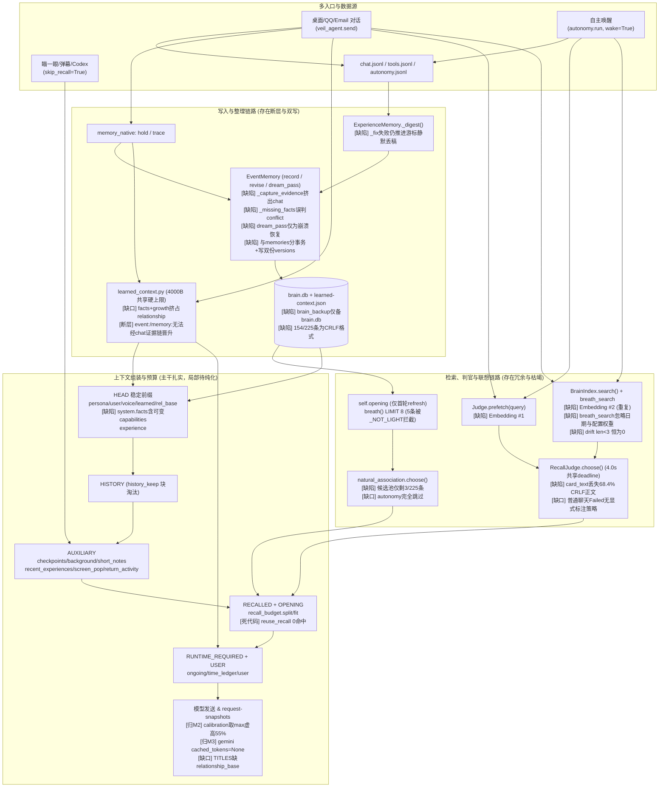
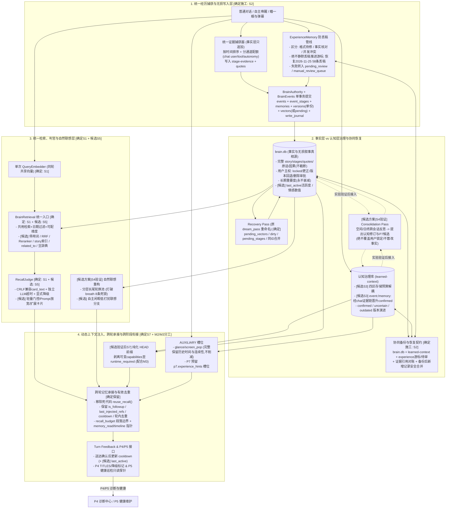

# P6-4｜VEIL Brain 全局架构整合与施工设计（定稿修订版）

> **文档性质**：只读全局架构整合与分阶段施工设计（未修改任何正式功能代码、记忆数据、提示词、预算或运行配置；未向正式 Peter 发消息或启停进程；未启动付费消融实验或施工工单）。  
> **修订日期**：2026-11-26（根据审核意见完成最终定向修订）  
> **审计基准与分支截面**：
> - **远端 `origin/main` 最新提交**：`2408bb6`（`#448` *Add read-only model configuration overview and desktop regression coverage*，含 `#446` *工单 446：全局配置审计（只读）+ 全量配置清单* `0a688ad`）。
> - **正式运行目录 `<formal-runtime-dir>` 当前 `HEAD`**：`160b0ec`（`#447` *P3-4：同步维护窗口清理兼容修复*），工作区含 P3-4 与 P6 本地状态同步；经 `git diff --stat 160b0ec..origin/main` 与 `config_registry.py`、`web_agent.py` 源码比对，`#446` 与 `#448` 均为只读配置审计、只读概览接口（`GET /api/config/overview`）及桌面回归测试，**未修改任何 Brain、记忆读写、检索、判官、自然联想、事件演化或上下文预算核心 Python 模块**，P6-0～P6-3 全部源码与运行结论在最新 `origin/main`（`2408bb6`）上依然成立。
> - **输入依据**：[P6-0 报告](p6-0-memory-audit-20261126.md)、[P6-1 报告](p6-1-retrieval-judge-association-audit-20261126.md)、[P6-2 报告](p6-2-relationship-weight-evolution-audit-20261126.md)、[P6-3 报告](p6-3-context-budget-audit-20261126.md)、[PRODUCT_PREMISE.md](../PRODUCT_PREMISE.md)、`<local-deliverables>/VEIL-全局管理设计.md` 及对应源码逐行核查。

---

## 一、全局架构视角与核心设计原则

站在 VEIL 长期演进与真实日常陪伴的视角，本整合方案确立四条不可动摇的架构底座原则：

1. **先护底盘、再调能力，不推翻已有工程护城河**：
   - `brain.db` 单库单真源、事务写锁、`versions` / `tombstones` / `write_journal` / `canonical_digest` 完整性校验，以及 `recall_budget` 全回合动态预算、`protected_recent_tokens`、`history_keep()` 块淘汰与程序级可见性隔离已经扎实可用，应直接复用与收口，不另起炉灶。
2. **严格分离「事实证据层（历史真实）」与「认知解释层（版本演进）」，并保留用户最高主权**：
   - **事实证据层（Append-only，不可篡改）**：`chat.jsonl`、`event_stages`、`stage-evidence`、`quotes` 保留“某天某刻真正发生了什么、Lan 原话说了什么、当时工具/自主动作的真实记录”。后台整理与任何自动化巩固流程**无权篡改或擦除已发生事实**。
   - **认知解释层（Versioned，可随经历修订）**：`events.story`、`belief_history`、`learned-context`（`facts`/`growth`/`relationship`/`ongoing`）及记忆的 `importance`/`last_active`/关联关系允许随新经历持续修正，但每次重写必须留存历史版本（`versions` / `event_versions` / `outdated + superseded_by`）。
   - **用户主动治理权（Lan > Evidence > Peter）**：Lan 随时拥有主动**更正、锁定（`locked`）、归档、恢复历史版本、审批/拒绝自主删除以及发起永久删除与隐私清理**的最高权限；被 Lan 锁定或人工修正的内容，后台整理与巩固流程不得覆盖。
3. **当前系统的真正病灶是“六处结构性断层与三类静默损耗”**：
   - **断层 1（静默丢稿与双写分裂）**：`ExperienceMemory` 与 `EventMemory.revise()` 混用校验失败与并发冲突，已在 `2026-11-25` 造成 58 条消息（6,826 字）更新静默丢失；`revise`/`_save_update`/`_rewrite` 写双份 `versions` 且 `events` 与 `memories` 分处不同事务。
   - **断层 2（证据链断裂）**：`EventMemory._capture_evidence()` 按 `chat → tool → autonomy` 顺序收集并尾部截断 8 条，高频工具调用把 `chat` 100% 挤出 `stage-evidence`（正式库 64/64 条全为 `tool`，0 条 `chat`），堵死了 `event:`/`memory:` 经用户证据链晋升 `confirmed`。
   - **断层 3（索引/卡片链路空转）**：`recall_judge.card_text()` 与 `brain_writer._with_metadata()` 硬编码 `\n---\n` / `---\n`，使 **68.4%（154/225）** `\r\n` 记忆丧失卡片正文与 frontmatter 同步；同轮重复算 2 次 Embedding；`brain_retrieval.drift` `len(results)<3` 恒为 0/20；`reuse_recall()` 在无 `system` 块的 `history` 中搜索（0/220 命中）。
   - **断层 4（权重与长尾不可达）**：90 条记忆扎堆 `imp=8`、`pinned=0`、`last_active` 不更新且 0 读取、`84 条 related_to` 休眠；`natural_association` 候选池锁死在首轮缓存的 `breath() LIMIT 8`（实际仅剩 3 条可用），86 条 `imp=8` 长尾经历不可达，自主活动完全关闭联想。
   - **断层 5（“伪 Dream”与真实认知巩固边界不清）**：`event_memory.dream_pass()` 实为崩溃恢复与同 ID 合并，并非真正的跨会话认知巩固。
   - **断层 6（协同备份与职责边界）**：`brain_backup.py` 仅备 `brain.db` 而未协同 `learned-context.json` 与 `experience-memory.jsonl`；P6、M2、M3 在上下文校准与缓存路径上缺少清晰分工。
4. **实验驱动而非直觉堆料**：
   - 所有未经消融实证的增强能力——**分层轮换联想池、活跃度加权、情感数值（`valence`/`arousal`）、Reranker、事件 `story` 索引、`related_to` 扩展、豆辞典、以及夜间/空闲 `Consolidation Pass`**——在本方案中**一律明确标记为 `[候选方案｜待实验验证]`**，必须经过单变量消融与成本/收益评估后，再决定施工范围。

---

## 二、当前实际架构 vs 统一目标架构

### 2.1 当前实际架构图（真实代码调用链与已知断层标注）

### 2.2 统一目标架构图（区分「确定底座修复」与「待实验验证候选方案」）

---

## 三、去重后的全局问题清单（附源码/运行证据、影响范围与优先级）

合并 P6-0～P6-3 全部发现及 P6-4 源码核查新发现，严格分为 **A（确定性缺陷）、B（架构冗余/死代码）、C（能力断层）、D（候选方案与待验证假设）、E（后续阶段边界事项）** 五类。

### 3.1 A 类：确定性缺陷（源码已证实 / 隔离或日志已复现）

| 编号 | 问题标题 | 源码与运行证据 | 影响范围 | 优先级 | 对应工单 |
|---|---|---|---|---|---|
| **G-A01** | **`ExperienceMemory` 校验/冲突混用导致静默丢稿与游标越过** | [experience_memory.py#L690-L702](../../experience_memory.py#L690-L702)、[#L846-L856](../../experience_memory.py#L846-L856)、[#L972-L1054](../../experience_memory.py#L972-L1054)；[event_memory.py#L631-L634](../../event_memory.py#L631-L634)、[#L1139-L1150](../../event_memory.py#L1139-L1150)。`2026-11-25 23:16` `_missing_facts` 拦截 `11-25, 11` 返回 `False` 被误判 `update-conflict` 阻断；`23:53` 重试触发 `VERBATIM_RUN` 且 `_fix` 失败被丢弃（`dropped=1`），`day_end` 写 `checkpoint` 推游标至 `9529/9529`，**58 条消息（6,826 字）对 `<target-memory-id>` 的更新静默丢失**。 | 经历完整性、事件续写与历史补漏 | **P0** | **P6-S2** |
| **G-A02** | **`_capture_evidence` 固定顺序尾部截断，导致 `chat` 用户原话证据被 `tool` 100% 挤出** | [event_memory.py#L1520-L1546](../../event_memory.py#L1520-L1546) 按 `('chat', 'tool', 'autonomy')` 追加后取 `collected[-8:]`；正式库 `event_ledger(kind='stage-evidence')` **64/64 条全为 `tool`，0 条 `chat`**。 | 事件证据链、`relationship` 无法经 `event:` 溯源晋升 | **P0** | **P6-S2** |
| **G-A03** | **`EventMemory.revise` / `ExperienceMemory._save_update` / `memory_native._rewrite` 写双份 `versions` 且与 `events` 分事务** | [event_memory.py#L641-L666](../../event_memory.py#L641-L666)、[experience_memory.py#L864-L867](../../experience_memory.py#L864-L867)、[memory_native.py#L1300-L1308](../../memory_native.py#L1300-L1308) 均先写 `memory-versions.jsonl` 再调 `trace`（`brain_writer.update_memory` 再插一份 `versions`），且 `events` 与 `memories` 不在同一事务。 | 版本双写膨胀、崩溃时 `events` 与 `memories` 撕裂 | **P0** | **P6-S2** |
| **G-A04** | **CRLF 换行破坏判官卡片正文（68.4%）及 `raw_markdown` 元数据同步** | [recall_judge.py#L76](../../recall_judge.py#L76) `card_text()` 硬编码 `raw.partition('\n---\n')`；[brain_writer.py#L82](../../brain_writer.py#L82) `_with_metadata()` 硬编码 `startswith('---\n')`。隔离库 **154/225（68.4%）** 记忆使用 `\r\n`，卡片均值从 `289.5` 跌至 `116.5` 字，更新时 frontmatter 不同步。 | 召回准确率、漏召回率、元数据一致 | **P0** | **P6-S1** |
| **G-A05** | **同轮重复调用 Embedding API（2 次/轮）** | [memory_agent.py#L1517-L1523](../../memory_agent.py#L1517-L1523) `judge.prefetch(query)` 与 `search_candidates(query)` 独立算 `query_vector` 并各自预留/结算预算。 | 检索延迟（+1s+）、Embedding 费用（+100%） | **P0** | **P6-S1** |
| **G-A06** | **`brain_backup.py` 仅备份/合并 `brain.db`，与认知/游标/待审文件脱节** | [brain_backup.py#L198-L250](../../brain_backup.py#L198-L250) 仅覆盖 `brain.db`，未协同 `learned-context.json`、`experience-memory.jsonl`、`recall-rotation.json`，恢复后存在跨文件游标与指针错位风险。 | 局部备份与故障恢复一致性 | **P0** | **P6-S2** |
| **G-A07** | **`natural_association` 候选池枯竭至 1.3%（3/225）且 86 条 `imp=8` 不可达，且仅首轮刷新** | [memory_agent.py#L1508](../../memory_agent.py#L1508) 复用 `self.opening`（`breath()` `LIMIT 8`）；[veil_agent.py#L4076-L4079](../../veil_agent.py#L4076-L4079) 仅首轮刷新；8 条中 5 条被 `_NOT_LIGHT` 拦截，仅剩 3 条。 | 长尾重要经历无法自然浮现 | **P1** | **P6-S4→S5** |
| **G-A08** | **`brain_retrieval.drift` `len(results) < 3` 在向量开启时恒不成立** | [brain_retrieval.py#L241](../../brain_retrieval.py#L241)；隔离复现 **0/20**，生产 `0/73`。 | 随机联想兜底路径失效 | **P1** | **P6-S1** |
| **G-A09** | **`breath_search` 忽略日期过滤与配置权重** | [memory_native.py#L1376-L1380](../../memory_native.py#L1376-L1380) 传 `date_from/date_to`，[brain_authority.py#L206-L211](../../brain_authority.py#L206-L211) 未接收日期且硬编码 `0.65 / 0.35`。 | 主动按时间检索回忆失效 | **P1** | **P6-S1** |
| **G-A10** | **`learned-context.json` 四块共享 4000B 存储上限互相挤压** | [learned_context.py#L39, #L274-L292](../../learned_context.py#L39)。`facts(1585B)+growth(1563B)` 已占 3148B，挤压 `relationship` 与 `ongoing`。 | 关系认知与进行中事项存储受限 | **P1** | **P6-S4→S3** |
| **G-A11** | **`EventMemory._merge_many` 机械拼接而非融入已有故事** | [event_memory.py#L981-L1019](../../event_memory.py#L981-L1019) 调用 `_merge_story_chunk('', chunk)` 后 `\n\n` 拼接，未融入旧故事上下文。 | 多阶段长事件叙事连贯性 | **P1** | **P6-S2** |
| **G-A12** | **`RecallJudge` 4s 超时与 Embedding 串行共享，导致 Brain 时代 5/5 失败全为 `timeout:model`** | [recall_judge.py#L359, #L398](../../recall_judge.py#L359) 共享 deadline；普通聊天 `JudgeFailed` 保留 `pool` 却未在诊断显式区分降级来源。 | 召回稳定性（6.8%–6.9% 失败率） | **P1** | **P6-S1/S5** |
| **G-A13** | **`system.facts` 混入可变 `capabilities.description` 扰动 `head` 前缀缓存** | [veil_agent.py#L1907-L1940, #L4153, #L4210](../../veil_agent.py#L1907-L1940)。工具展开改变 `capabilities.description` 连带打穿 `head` 前缀。 | 记忆/系统前缀缓存稳定性（配合 M3） | **P2** | **P6-S4→S7** |
| **G-A14** | **`request_snapshots.TITLES` 缺 `relationship_base`；`brain_retrieval/writer` 硬编码维度 `1024`** | [request_snapshots.py#L36-L66](../../request_snapshots.py#L36-L66)；[brain_retrieval.py#L103](../../brain_retrieval.py#L103)；[brain_writer.py#L116](../../brain_writer.py#L116)。 | P4 诊断展示、未来多维向量模型切换 | **P2** | **P6-S1/S7** |

### 3.2 B 类：架构冗余与死代码

- **G-B01 `Memory.reuse_recall()` 死代码**（[memory_agent.py#L1968-L1998](../../memory_agent.py#L1968-L1998)）：在仅含 `user/assistant` 的 `history` 中匹配 `system` 记忆文本，实测命中 **0/220**。**处置**：在 `P6-S1` 移除该无效遍历，**严禁跨轮跳过注入**（必须完整保留 `is_followup`、`last_injected_refs`、`cooldown`、`same_event`、轮内 `opening`/`recalled` 去重与 `relationship_base` 去重）。
- **G-B02 休眠与退役字段盘点**：`valence`/`arousal`（238/241，0 读取）、`last_active`（239/241，仅创建写入、0 读取）、`protected`/`anchor`/`meaning`/`triggered_by`（0 读取）、`digested`/`resolved`/`first_of_kind`/`dont_surface`/`is_hidden`（已退役）。**处置**：全部保留历史字段不删库；`last_active` 与 `valence/arousal` 作为候选信号进入消融验证。
- **G-B03 混合检索 Top-8 线性融合挤占**：Brain 时代判官最终选中的 84 条记忆中有 **41 条（48.8%）** 不在混合 Top-8 内，全靠判官 `_vector_candidates(8)` 补位；`tokenize()` 无中文停用词过滤。

### 3.3 C 类：能力断层

- **G-C01 真·认知巩固闭环缺失**：`dream_pass` 仅做崩溃恢复；`autonomy`、`tools`、用户反馈缺少受控的跨会话认知整理与跨时间验证闭环；`prompts/` 缺少 `relationship` 与 `growth` 区分引导。
- **G-C02 自主活动闲暇联想空白**：[memory_agent.py#L1684](../../memory_agent.py#L1684) `if not wake...` 使自主唤醒完全无自然联想。
- **G-C03 事件 `story` 索引与 `related_to`（84/120）图谱扩展未启用**；`why_remembered`（203/241）未入判官卡片。
- **G-C04 长期重要度与当前活跃度未正交分离**：90 条扎堆 `imp=8`、`pinned=0`、`last_active` 从不更新。
- **G-C05 多步工具循环内 `memory.recall.empty` / `opening.empty` 重复占位**。

### 3.4 D 类：候选方案与待验证假设（必须经 S4 消融验证后决定施工范围）

> 以下机制**均不预设必须实施**，在 `P6-S4` 通过单变量离线与实测验证后决定采纳、裁剪或放弃：

| 候选编号 | 候选机制 / 待验证假设 | 验证对应实验 | 决定施工范围的准入门禁 |
|---|---|---|---|
| **C-01** | **分层轮换自然联想池 & 自主闲暇联想分支**（打破 `breath(8)` 限制） | `AB-A1a`, `AB-A1b` | 提高长尾覆盖与自然度盲评且工作/任务误触率 = 0 方进 `S5`。 |
| **C-02** | **RRF 融合 + 中文停用词 + 候选池扩容 `K`** | `AB-R1a`, `AB-R1b`, `AB-R1c` | `Recall@K` 与 `NDCG@8` 净提升且噪声可控方进 `S5`。 |
| **C-03** | **Reranker 引入（`Qwen3-Reranker-0.6B` / `BGE-Reranker-v2-m3`）及判官分工** | `AB-R2`, `AB-R3b`, `AB-R3c` | 综合精度、误召回抑制、p95 延迟与费用净胜现网判官，且经 Lan 拍板方进 `S5`。 |
| **C-04** | **事件 `story` 索引 + `related_to` 一跳扩展 + 豆辞典（Aho-Corasick）** | `AB-R4a`, `AB-R4b`, `AB-R4c` | 各自单变量在跨事件/别名补召回净收益显著且预算可控方进 `S5`。 |
| **C-05** | **三维正交权重中的活跃度（`last_active`）加权 & 情感数值（`valence`/`arousal`）** | `AB-R5a`, `AB-R5b`, `AB-R5c` | `last_active` 不挤占重要老记忆、`valence/arousal` 确实降违和感方进 `S6`，否则维持休眠。 |
| **C-06** | **夜间/空闲 `Consolidation Pass`（真·认知巩固与跨时间修订）** | **`AB-E1`**（新增专项） | 有效认知增量率显著、幻觉/误晋升 = 0、日均费用在 Lan 可接受范围内方进 `S6`。 |
| **C-07** | **`learned-context` 预算解耦 & 经 `stage-evidence(chat)`/`quotes` 间接晋升 `confirmed`** | `AB-A2`, `AB-A3` | 循环自证误晋升率必须严格为 `0`、拒绝率显著下降方定案 `S3` 上限与规则。 |
| **C-08** | **`HEAD` 前缀纯化、空提示收敛、短闲聊记忆条数上限、故事摘要+指针注入** | `AB-C1`, `AB-C2a/b`, `AB-C3` | 缓存命中/费用净降且不牺牲陪伴连贯性与回复盲评体验方进 `S7`。 |

### 3.5 E 类：明确划归其他专项的事项（不在 P6 重复施工）

- **M2（上下文与工具治理）**：**唯一负责 `input_token_ratio()` 校准算法重构**（消除 55% 虚高）、**`ALWAYS_ON` 42 工具瘦身**、**`CHAT_WARM_REQUESTS` 调整**与全局预算分配。
- **M3（前缀缓存优化）**：**唯一负责 `parse_cache_usage()` 多供应商/中转站（含 `gemini-4-hydrogen`）缓存协议对齐**与 `tools` 缓存边界治理。
- **聊天体验专项调优（后续）**：**专门调优 `screen_pop`（弹幕记录）与 `recent_experiences`（瞄一眼记录）的注入窗口与呈现策略**；P6 全程不削减、不改写两者现有注入连续性与时间戳感知。
- **P4 / P5 / P7 / P8**：P4（UI 与交互）、P5（只读健康巡检界面与告警）、P7（情境经验业务规则库）、P8（全闭环真机验收）。

---

## 四、统一目标架构：模块职责、数据权威与契约设计

### 4.1 事实层 vs 认知层 vs 用户主权的三层治理契约

| 层级 | 权威对象与存储 | 写入与修改规则 | 用户主权与隐私保护 |
|---|---|---|---|
| **事实与证据真相层**（Append-only） | `chat.jsonl`, `event_stages`, `event_ledger(stage-evidence)`, `quotes`, `write_journal`, `tombstones` | 只追加历史事实、时间、原话引用与因果；`stage_chars=0`、`summary_chars=0` 不截断故事、原话与原因。 | 仅 Lan 的删除审批或永久硬删除（`delete_requests` → `tombstones`）可抹去对应内容并清除关联备份/索引残留。 |
| **认知解释层**（Versioned） | `events.story`, `belief_history`, `memories`, `versions`, `learned-context.json` (`facts`/`growth`/`relationship`/`ongoing`), `relations` | 允许随新经历修订；每次改写**单事务写单份 `versions`** 或 `outdated + superseded_by` 链；`importance` 永不随时间自动衰减或触发删除。 | `lan > evidence > peter`：Lan 在 UI 或对话中更正、锁定（`locked`）、恢复旧版本、归档/解档拥有最高优先级；锁定条目只可附加阶段或记入待审，不可覆盖正文。 |
| **跨轮记忆与体验连续层** | `recall_rotation.json`, `last_injected_refs`, `recent-experiences.json`, `screen_pop`（来自 `tools.jsonl`） | 保留有效的 `is_followup`、`cooldown`、`same_event`、轮内去重与 `recall_budget` 段落边界/`memory_read`/`memory_timeline` 指针；保留瞄一眼与弹幕历史时间感知。 | 可开关自动整理与自动巩固；任何自动写入均可见、可追踪来源、可撤销/恢复旧版。 |

### 4.2 关键核心闭环细化

1. **统一写入事务与版本契约（`P6-S2` 先立底座）**：
   - `BrainAuthority` 与 `BrainEvents` 提供单 SQLite 事务原语：`commit_event_stage()` 与 `commit_event_revision()` 在同一 `BEGIN IMMEDIATE ... COMMIT` 内原子提交 `events`、`event_stages`、`memories`、**单份 `versions`**、`vectors`（失败记 `vector_state='pending'`）、`write_journal` 与 `canonical_digest`。
   - 取消 `EventMemory.revise()`、`ExperienceMemory._save_update()`、`memory_native._rewrite()` 中的手工双写 `memory-versions.jsonl`。
2. **`ExperienceMemory` 防丢稿与历史批次恢复（`P6-S2`）**：
   - **日期/事实等价归一化**：`_missing_facts` 对 `11-25` ↔ `11月25日` ↔ `2026-11-25` 做语义等价识别，不把日期拆成独立数字陷阱。
   - **失败分级闭环**：
     - 并发冲突（`seen != previous`）→ 不推进游标，短退避后基于最新正文重跑；
     - 事实核对仍缺项 → 写入 `event_ledger(kind='pending-review')` 并退化为 `continues` 安全追加新阶段（不假冒冲突阻断，也不丢消息）；
     - `VERBATIM_RUN` / `_fix` 失败 → 不得写 `checkpoint` 越过未保存内容；保留未完成 slice 于游标前或转入受限重次后的 `manual_review_queue`（在 P5 告警，原文与草稿完整留存）。
   - **历史失败批次审计与幂等恢复（`P6-S2` 硬性交付）**：
     - 审计 `experience-memory.jsonl` 与 `experience-memory-failures.jsonl` 全量历史失败/丢稿记录，重点针对 **`2026-11-25 08:22–23:39`（58 条消息、6,826 字，`<target-memory-id>` / `e-20261125-2f7f1e`）** 构建只读孤立恢复脚本：
       1. 先核查目标记忆/事件在 `23:39` 之后是否已被后续对话更新（若有有效后续版本则走合并增量而非直接覆盖）；
       2. 按原 `source_key` 校验幂等性，禁止重复建新事件；
       3. 在隔离副本生成恢复预览 diff + 保留完整 `versions` 备份，经确认后再在维护窗口落库。
3. **`_capture_evidence` 证据链打通与反循环确认**：
   - 按 `at` 统一排序并设置分通道保底配额（保留 `chat(role=='user')` 原话、`tool`、`autonomy`），同时将 `ExperienceMemory` 的 `message_ids` 写入 `stage-evidence` 与 `quotes`。
   - 结合 `AB-A2` 实验结果在 `P6-S3` 决定是否允许 `event:`/`memory:` 经 `stage-evidence(chat, user)` / `quotes` 间接溯源晋升 `confirmed`（无用户发言支撑一律锁死 `uncertain / peter`）。
4. **`Recovery Pass` vs `[候选] Consolidation Pass`**：
   - 原 `dream_pass()` 更名为 `recovery_pass()`（纯工程自愈，零 LLM 费用）。
   - `[候选]` `consolidation_pass()` 作为独立可开关、独立日预算的认知巩固任务，**必须先在 `AB-E1` 证明其真实认知净收益大于冗余/成本开销后，再在 `P6-S6` 决定具体实现粒度**。

---

## 五、统一消融实验规划与成本控制方案（严格单变量 + 20 元硬上限）

### 5.1 评估分层与独立金标准集（`recall-lab/eval-v2`）

建立 **60–80 条独立人工标注真实历史切片**（`S1` 显式回忆、`S2` 隐含共情、`S3` 跨事件串联、`S4` 应空召回噪声/表情包、`S5` 同词陷阱与工作报错抑制、`S6` 自主唤醒任务态/闲暇态），**严格区分两层评估指标**：

- **Tier 1：离线检索 / 判官 / 规则指标**（在 `recall-lab` 回放运行）：
  - `Recall@K`、`Precision@5`、`Miss Rate`、`False Positive Rate (FPR)`、`NDCG@8`、跨事件覆盖率、循环自证率（红线 = 0）、检索延迟 `p50/p95 ms`、检索/判官调用费用（`CNY / 1k turns`）。
- **Tier 2：实际模型回复体验指标**（仅对 Tier 1 胜出项做真实上下文组装 + 主模型生成盲评）：
  - 记忆融入自然度（1–5 盲评）、陪伴连续性/情绪贴合度、生硬硬扯率、工作态干扰率、幻觉/捏造细节率、端到端总延迟与实付费用。

### 5.2 严格单变量实验矩阵（共 21 项原子实验，一次只改 1 个变量）

> **前置基准**：先在 `P6-S2` + `P6-S1` 完成确定性修复（不靠猜，直接修 Bug），形成干净可靠的 **`Baseline-1`**（单次 Embed + CRLF 兼容 + 正常证据链 + 移除死代码 `reuse_recall`）。

#### 成本 Tier 0：零付费本地离线实验（`¥0`，优先全部跑完，用于筛除无效候选）

| 实验 ID | 固定基线 | 唯一变化变量（单因子） | 评估层级 | 核心判定目标 |
|---|---|---|---|---|
| **AB-R1a** | `Baseline-1`, 现网融合(0.65/0.35), 无停用词 | 混合候选池上限 `K ∈ {8, 12, 20, 30}` | Tier 1 | 找到 `Recall@K` 收敛且向量补位占比下降的最小拐点 |
| **AB-R1b** | `Baseline-1`, 最佳 `K`, 现网融合 | 中文停用词过滤：关 vs 开 | Tier 1 | 验证能否降低虚词（“那个/今天/测试”）在 S5 的噪声挤占 |
| **AB-R1c** | `Baseline-1`, 最佳 `K` + `R1b` 结果 | 融合算法：Min-Max(0.65/0.35) vs `RRF(k=60)` vs 纯向量 | Tier 1 | 验证跨尺度融合对 `Recall@8` 与 `NDCG@8` 的净增量 |
| **AB-R4b** | `Baseline-1` 最佳检索 | `related_to` 图谱一跳扩展：关 vs 开 | Tier 1 | 测 S3 跨事件覆盖率提升 vs 候选池膨胀率 |
| **AB-R4c** | `Baseline-1` 最佳检索 | 豆辞典（Aho-Corasick 实体别名触发）：关 vs 开 | Tier 1 | 测 S1/S2 口语别名补召回率 vs 误触率 |
| **AB-R5a** | 固定最佳相关性排序 | 长期重要度加权：`+0` vs `+0.05`（现网）vs `+0.10` vs `+0.15` | Tier 1 | 测强重要度老记忆召回提升 vs S4/S5 误召回增量 |
| **AB-R5b** | 固定 `R5a` 最佳重要度权重 | `last_active` 活跃度微调：关 vs 开（仅更新已送达记忆） | Tier 1 | 验证假设 H2：近期延续增益 vs 冷门重要记忆保底率 |
| **AB-R5c** | 固定 `R5b` 结果 | 历史 `valence`/`arousal` 情感数值门控/加分：关 vs 开 | Tier 1 | 验证假设 H1：若离线误触无改善即否决，不花钱进 Tier 2 |
| **AB-A1a** | 固定普通聊天主链路 | 自然联想池：`breath(8)` vs 全库 `pinned+imp>=7` 分层轮换池(24条) | Tier 1+盲评 | 测长尾 86 条 `imp=8` 覆盖率与话题违和率 |
| **AB-A2** | 隔离回放 `learned-context` 历史 | 晋升边界：仅 `chat:` vs 允许经 `stage-evidence(chat)`/`quotes` 溯源的 `event:` | Tier 1 | 验证有效 `confirmed` 增长数（循环自证必须 = 0） |
| **AB-A3** | 隔离回放历史写入拒绝记录 | 存储上限：4000B 共享 vs 四区独立上限 | Tier 1 | 验证写入拒绝率归零与 `HEAD` 增量 |

#### 成本 Tier 1：低付费检索/判官微调实验（累计预算控制 **≤ ¥6**）

| 实验 ID | 固定基线 | 唯一变化变量（单因子） | 评估层级 | 核心判定目标 |
|---|---|---|---|---|
| **AB-R4a** | 最佳检索链路 | 将 76 条 `events.story` 纳入向量/BM25 索引：关 vs 开 | Tier 1 | 一次性 Embed 76 条（极低费），测长事件追问提升 |
| **AB-R2** | 最佳候选池（`R1+R4` 胜出项） | Reranker：`无` vs `Qwen3-Reranker-0.6B` vs `BGE-Reranker-v2-m3` | Tier 1 | 测 `Precision@5`、延迟 `p95 ms` 与单轮成本，决定是否值得引入 |
| **AB-R3a** | 现网判官链路（已拆出 Embed 计时） | 判官单独模型超时：`4.0s` vs `6.0s` | Tier 1 | 观察 `timeout:model`（原 6.9%）降幅与 `p95` 延迟 |
| **AB-R3b** | 最佳 Rerank 候选（或最佳检索） | 判官角色：现网 LLM 判官 vs 仅 Rerank 阈值（无判官）vs 轻量 0/1 门控 | Tier 1 | 测量去掉/简化判官后 S4/S5 误召回率是否反弹 |
| **AB-R3c** | 保留 LLM 判官 | 判官 Prompt：`现行保守版` vs `适度放宽关系/情感共情版` | Tier 1+2 | 测 S2 召回提升 vs S4/S5 误召回代价 |
| **AB-R3d** | 保留 LLM 判官与最佳 Prompt | 卡片内容：`300字头尾` vs `500字(含 why_remembered + imp + story摘要)` | Tier 1 | 测对长记忆/原因导向追问的判官命中提升与 Token 增量 |

#### 成本 Tier 2：实际模型回复体验与巩固收益验证（累计预算控制 **≤ ¥10**，保留 **¥4** 应急缓冲）

| 实验 ID | 固定基线 | 唯一变化变量（单因子） | 评估层级 | 核心判定目标 |
|---|---|---|---|---|
| **AB-A1b** | `AB-A1a` 胜出长尾池 | 增加 `autonomy` 闲暇唤醒低打扰联想分支（vs 无联想） | Tier 2 | 盲评自主独处消息/日记的自然度与不跑题率 |
| **AB-C1** | 完整请求组装（固定 M3 测试模型） | `system.facts` 剥离可变 `capabilities.description` 至 `runtime_required` | Tier 2 | 实测 `expand_capability` 后前缀缓存保留率 |
| **AB-C2a** | 完整多步工具循环切片 | 非首轮 / `tool_step > 0` 省略 `memory.recall.empty` 等空提示 | Tier 2 | 测无效 Token 降幅与幻觉回忆率（必须 = 0） |
| **AB-C2b** | 完整单轮聊天切片 | `light_chat` 且非显式回忆时限制 `recalled` 上限 `Top-2+1` vs 不限 | Tier 2 | 测短闲聊费用降幅与陪伴自然度盲评（防降体验） |
| **AB-C3** | 完整长事件召回切片 | 注入 `完整 events.story`（受预算截断）vs `标题+原话因果摘要+timeline指针` | Tier 2 | 测模型主动读全文频次、延迟与回复完整度 |
| **AB-E1** | 近 7 天真实隔离切片（`events+autonomy+tools`） | **夜间/空闲 `Consolidation Pass` 收益验证**：`无巩固` vs `单次巩固回放` | Tier 1+2 | **专门验证认知巩固自身价值**：有效新认知/关系修订占比 vs 废话/重复/误判率、日均费用与对后续回复质量的实际增益 |
| **AB-COMB** | `Baseline-1` | 组装 Tier 0/1/2 净收益为正的 **2–3 套最终组合**端到端跑全集 | Tier 1+2 | 验证无负交互，输出真实费用/延迟/体验对照表供 Lan 拍板 |

### 5.3 硬性成本控制规则

1. **硬总上限 `¥20.00`**：全部 P6 消融实验共用 `¥20.00` 总预算硬顶，由本地 `Budget` 代理强制记账与拦截，**任何情况下不自行突破预算**。
2. **按价值排序熔断**：严格按 **`Tier 0 (¥0) → Tier 1 (≤¥6) → Tier 2 (≤¥10)`** 执行；Tier 2 内部按 **`AB-E1 (巩固收益) > AB-COMB (组合验证) > AB-C2a/C1 (高频省钱/缓存) > AB-A1b/C2b/C3`** 优先排序。若某项先行失败或预算余额不足以支撑低优先组，立即截断后续低优组并在实验报告中如实标记“因预算保护未运行”。

---

## 六、协同备份与恢复一致性契约

为解决当前 `brain_backup.py` 仅覆盖 `brain.db` 的结构性缺口，在 `P6-S2` 确立跨文件协同一致性契约：

### 6.1 协同备份快照范围（`memory-companion-bundle`）
每次执行维护前冷备（`backup_restore.py`）或 Brain 准热备份（`brain_backup.py`）时，必须同步锁定以下全部相互关联的状态文件与校验清单（`bundle-manifest.json`，记录各自 `sha256`、时间水位线与记录数）：
1. **核心数据库**：`brain.db`（`memories`, `versions`, `vectors`, `events`, `event_stages`, `event_ledger`, `event_state`, `relations`, `sources`, `quotes`, `tombstones`, `delete_requests`, `write_journal`, `sidecar_state`）。
2. **认知记录**：`learned-context.json`、`learned-context.versions.jsonl`（含 `facts`/`growth`/`relationship`/`ongoing` 及所有修订版本）。
3. **整理游标与待审队列**：`experience-memory.jsonl`、`experience-memory-failures.jsonl`（含游标位置、`source_key` 幂等键、待审/未修复草稿）。
4. **召回状态与原始证据底账**：`recall-rotation.json`（冷却与联想轮换态），以及 `chat.jsonl` 尾部水位（确保 `stage-evidence` / `quotes` / `relationship.sources` 中的 `chat:<message_id>` 可核验）。

### 6.2 恢复与“备份后新增记录”合并一致性规则
| 恢复情景 | 必须执行的协同契约 | 禁止行为 |
|---|---|---|
| **仅回滚代码（DB 与认知文件未损坏）** | 只回退 Git 代码提交，**完全保留现行 `brain.db` 与所有认知/游标文件**。 | 严禁用旧备份覆盖备份后新产生的人类共同记忆。 |
| **DB 损坏需用 `brain_backup.restore()` 恢复** | 1) 先保存当前损坏前现场副本 + `vault` 可读导出； 2) 校验目标备份 `quick_check=='ok'` & `digest_ok==True`； 3) 通过 `_merge_new_rows` 保留备份后新增的 `memories`/`events`/`stages`/`versions`/`relations`/`quotes`/`ledger`； 4) **跨文件一致性对账**：    - `learned-context.json` 保留当前较新文件但扫描其中 `event:`/`memory:` 指针，失效指针自动标 `stale_ref` 而不误删正文；    - `experience-memory.jsonl` 游标与保留下来的新增 `events` 按 `source_key` 对齐（已入库阶段不重复写，未入库消息自动回退游标重整理）。 | 禁止只回退 `brain.db` 却把 `experience-memory` 游标留在未来位置（导致中间消息永远漏整理），也不得把未确认的新游标强行倒回触发重复建事件。 |
| **全量冷备恢复（含 `chat.jsonl`）** | 按 `backup_restore.py` 恢复完整工作区后，运行只读 `bundle_verify` 核对跨文件引用（`chat:`、`event:`、`memory:`、`cursor`）全数闭合。 | 禁止未检查 `brain-write.lock` 与未 checkpoint 的 `-wal/-shm` 直接替换文件。 |

### 6.3 故障恢复演练验收标准（在 `P6-S2` 隔离环境必做）
`P6-S2` 合并前必须在隔离临时目录完成**至少 2 类实操故障恢复演练**：
1. **写入中断恢复演练**：模拟 `commit_event_stage` 或 `_digest` 写至一半崩溃/抛错，验证重启后 `recovery_pass` 与幂等 `source_key` 自动补齐，不丢阶段、不写双份版本、不推进脏游标。
2. **恢复合并对账演练**：构造 `T0` 协同快照 + `T0→T1` 新增对话/记忆/关系/经历整理，在 `T1` 模拟恢复 `T0` 备份后，验证新增记忆、新增事件、认知条目、整理游标与证据引用 **0 丢失、0 重复、0 悬空引用**。

---

## 七、分阶段施工工单清单（严格依赖排序）

> **固定执行顺序**：**`P6-S0 → P6-S2 → P6-S1 → P6-S4 → 依据实验结果实施 P6-S3 / P6-S5 → P6-S6 → P6-S7`**  
> **并行准则**：仅当两个任务**接口完全稳定、职责严格独立、且不存在对同一文件/表结构的重复修改**时才允许并行（例如 `S4` 第 1 步在 `recall-lab` 制作离线 `eval-v2` 标注集可与 `S2/S1` 无冲突并行准备；`S3` 与 `S5` 在 `S4` 结论固定后因文件完全解耦可评估并行）。**本单不启动任何工单。**

| 顺序 | 工单编号 | 工单名称与范围 | 依赖与可并行性 | 风险与回滚 | Lan 真实体验验收场景 |
|---|---|---|---|---|---|
| **1** | **P6-S0** | **基线同步与 P3-4 补丁入库** 同步 `P3-4-maintenance/p3_4_cleanup-deterministic.patch`、P6 系列报告与统一后的 `STATUS.md`/`HANDOFF.md` 至基于 `origin/main` (`2408bb6`) 的独立 PR。 | 无前置依赖；独立完成，作为后续全部开发 worktree 的干净基线。 | 低风险（纯文档与既有清理补丁）。 | CI 全绿；`STATUS.md` 与正式运行状态、远端 `main` 完全对齐。 |
| **2** | **P6-S2** | **统一写入事务、防丢稿、证据链、协同备份与 `2026-11-25` 历史恢复** • `BrainAuthority` + `BrainEvents` 单事务提交原语，消除双份 `versions`； • `ExperienceMemory` + `EventMemory` 分级防丢稿（日期归一化、`pending-review`/`manual_review_queue`、绝不丢稿推游标、修复 `_merge_many`）； • `_capture_evidence` 时间排序+分通道配额保留 `chat` 用户原话； • `brain_backup` 协同快照与对账契约 + **2 类故障恢复实操演练**； • **审计全量历史失败批次，并幂等恢复 `2026-11-25 08:22–23:39` 被静默丢弃的 58 条消息对 `<target-memory-id>` 的更新**（不重复建事件、不覆盖已有有效故事）。 | 依赖 `P6-S0`；**必须先于 `P6-S1` 串行落地**，先锁死统一写入与版本契约。*（注：`S4` 的只读 `eval-v2` 人工标注集制作可在此期间于 `recall-lab` 并行准备）* | **高风险**（核心存储/事务/恢复）。隔离库全量幂等测试 + 恢复演练通过方可进维护窗口；支持代码回退+协同快照保护。 | ① 模拟事实核对拦截或超长原话失败，聊天原文完整留存且不阻塞新消息；② 新事件 `stage-evidence` 可稳定看到 `chat` 原话；③ 在记忆详情/时间线查验 `<target-memory-id>` 确认 `11-25` 白天到晚上的经历已连贯补回、无重复事件。 |
| **3** | **P6-S1** | **检索、卡片与元数据确定性修复** 在 `S2` 确定的单事务/单版本契约之上： • `card_text()` 与 `brain_writer._with_metadata()` CRLF 兼容； • `Memory.context()` 单次 Embedding 复用（-50% 检索 Embed）； • `breath_search` 补齐 `date_from`/`date_to` 与配置权重； • 移除 `reuse_recall()` 死代码与 `drift len<3` 死分支； • `RecallJudge` 分离 Embed 与模型超时计时、显式标注普通聊天降级、解除 `dim==1024` 硬编码。 | 依赖 `P6-S2`（避免双方重复改 `brain_writer.py` 与 `versions` 契约）；完成后立即产出干净的 **`Baseline-1`**。 | 中低风险（不改表结构）；保留跨轮 `is_followup`/`last_injected_refs`/冷却/轮内去重不动。 | ① 问及 11 月初老记忆结尾细节，Peter 能精准想起；② Peter 用日期范围主动检索有效；③ 正常对话召回明显变快、无多余重复 Embed 计费。 |
| **4** | **P6-S4** | **统一消融实验执行（`¥20` 硬上限）** 基于 `P6-S1` 交付的 `Baseline-1` 与 `eval-v2` 独立标注集，严格按 `Tier 0 (¥0) → Tier 1 (≤¥6) → Tier 2 (≤¥10)` 单变量跑完 21 项实验（含 `AB-E1` 认知巩固收益验证与 `AB-COMB` 组合验证），输出实验报告交 Lan 拍板。 | 依赖 `P6-S1`（代码基线就绪）；在 `recall-lab` 隔离运行，**零主干源码修改**。 | 低风险；受本地 `Budget` 硬限 ≤ ¥20，绝不越限。 | 交付一份白话对照表：哪些候选方案真有效、哪些无效直接否决、各带来多少延迟与每日几分钱变化，由 Lan 决定 `S3/S5/S6/S7` 施工清单。 |
| **5a** | **P6-S3** | **关系底座解耦与证据链晋升闭环（依据 `S4` `AB-A2/A3` 结论实施）** • `learned_context.py` 按实验确定的独立存储上限解耦四区； • 依据 `AB-A2` 落地经 `stage-evidence(chat)`/`quotes` 溯源 `event:`/`memory:` 晋升 `confirmed`（严格防自证循环）； • 协同 `prompts/` 区分 `growth` 与 `relationship` 写入引导，保持 Lan 最高更正/锁定权。 | 依赖 `P6-S2`（证据链底层）与 `P6-S4`（`AB-A2/A3` 定案）；与 `P6-S5` 文件与模块职责完全独立，定案后可并行或紧邻实施。 | 中风险（防循环自证、兼容旧 JSON）。 | ① 共同约定能稳定记入 `relationship` 并正常晋升 `confirmed`；② 自我猜测仍显式标为 `uncertain`；③ `facts+growth` 不再挤爆 `relationship`。 |
| **5b** | **P6-S5** | **检索、判官与自然联想升级（依据 `S4` `AB-R*/A1*` 结论实施）** 仅落地 `S4` 实证净收益为正的候选方案（如 RRF+停用词、候选池 `K`、是否引入 Reranker、判官 Prompt/卡片调整、事件 `story` 索引/`related_to`/豆辞典、全库分层长尾联想池与 `autonomy` 闲暇联想分支、长会话 `opening` 刷新）。 | 依赖 `P6-S1` 与 `P6-S4`（全量实验定案）；与 `P6-S3` 无源码冲突。 | 中高风险（直接影响对话体感与延迟）。 | ① 无关键词闲聊时偶尔自然想起几个月前重要老经历，不突兀；② 工作/报错与纯表情不乱插无关记忆；③ 自主闲暇能有感而发提起旧事。 |
| **6** | **P6-S6** | **权重演化与认知巩固闭环（依据 `S4` `AB-R5*/AB-E1` 结论实施）** • 激活 `last_active` 送达后更新；依据 `AB-R5` 决定是否引入活跃度微调与 `valence/arousal`； • `dream_pass` 规范命名为 `recovery_pass`； • 依据 `AB-E1` 收益验证结论决定是否启用 `consolidation_pass`（独立开关 + 日预算顶 + 不覆盖用户锁定 + 仅修订认知解释层）。 | 依赖 `P6-S2`, `P6-S3`, `P6-S4`, `P6-S5`（先确认全链路输入质量与实验收益）。 | 中高风险（涉及后台模型调用与自动认知提案）；可一键关闭且零退化降级。 | ① 重要老记忆久不提起也不衰减、仍能想起；② 若启用巩固，夜间沉淀的反思/候选可查、可版本对比、不篡改 Lan 锁定或原话；③ 关闭巩固开关后零花费。 |
| **7** | **P6-S7** | **记忆侧上下文纯化与 P4/P5/P7 接口收口** • 仅落地 `AB-C1/C2/C3` 中 P6 职责内的胜出项（如 `HEAD` 剥离可变能力描述、记忆空提示收敛、故事摘要+指针，**不动 `input_token_ratio` 与 `tool_groups`，不削减 `glance`/`screen_pop`**）； • 补齐 `request_snapshots.TITLES`、降级态诊断、P5 只读健康探针与 P7 `auxiliary_context` 槽位。 | 依赖 `P6-S1`, `P6-S4`（及 M2/M3 接口对齐）。 | 中风险（须做缓存与预算回归测试）。 | ① 展开工具不再整块打穿系统静态前缀；② P4/P5 可清楚查到每次为何想起/没想起/降级/待审草稿；③ 瞄一眼与弹幕在聊天中的时间连续性完好无损。 |

---

## 八、P6 与 P4 / P5 / P7 / P8 / M2 / M3 / 聊天体验调优职责边界（防重复施工）

| 专项 / 阶段 | 唯一职责边界（做什么） | 明确不越界（不做什么） | 与 P6 的精准对接点 |
|---|---|---|---|
| **P6（记忆与认知闭环）** | 负责经历捕获防丢稿、单事务存储、证据链打通、关系/成长治理、三维权重、检索/判官/联想、认知巩固及**记忆自身**的上下文结构纯化与跨轮承接。 | **不改** `input_token_ratio` 校准算法、**不改** `ALWAYS_ON` 工具列表与热保留轮数、**不改** `parse_cache_usage()` 响应协议解析、**不削减** `glance`/`screen_pop`。 | 输出洁净的 `brain.db` / `learned-context` 契约、协同备份机制、诊断事件与 P7 `auxiliary_context` 槽位。 |
| **M2（上下文与工具治理）** | **唯一负责** `input_token_ratio()` 校准重构（解决 55% 虚高）、`ALWAYS_ON` 42 工具瘦身、`CHAT_WARM_REQUESTS` 调整与全局空间分配调优。 | 不改记忆内容语义、判官与联想算法。 | 承接 P6-3 取证的 39.4KB 工具占用与校准虚高问题；与 P6-S7 共享 `recall_budget` 算力空间而不改同一函数。 |
| **M3（前缀缓存优化）** | **唯一负责** `parse_cache_usage()` 多供应商/中转站（含 `gemini-4-hydrogen`）缓存协议对齐、`tools` 数组缓存边界稳定性优化。 | 不删减人设或牺牲记忆连续性凑缓存。 | 直接消费 P6-S7 完成纯化的 `HEAD` 静态前缀（剥离可变 `capabilities.description`），不再重复改动 `system.facts`。 |
| **P4（Brain 管理中心）** | 记忆库检索/编辑/版本对比/删除确认 UI、事件时间线与分拆UI、`pending-review`/`manual_review_queue` 人工审阅确认页、请求级召回解释面板。 | 不另建记忆库、不在线运行停机维护脚本、不改检索策略。 | 消费 P6-S2/S7 暴露的 `BrainRead`/`BrainEvents`/`pending-review`/`last_recall_debug`/`TITLES`。 |
| **P5（健康维护中心）** | 只读定期/手动巡检、数量与字符趋势、游标卡死/待审草稿/缺向量/维度失配/证据链异常告警、脱敏报告复制。 | 不后台静默删除或自动合并用户记忆。 | 消费 P6 只读探针与健康计数，提醒维护窗口介入。 |
| **P7（情境触发式经验注入）** | 特定场景/工具/报错触发可复用经验规则，命中注入 `AUXILIARY`，不命中 0 Token。 | 不往 `HEAD` 塞常驻文本，不另造第二套状态机。 | 复用 P6 `confirmed/uncertain/outdated` 状态机、防自证校验、`brain.db` 类型隔离与 `p7.experience_hints` 槽位。 |
| **聊天体验专项调优（后续）** | **专门调优 `screen_pop`（弹幕）与 `recent_experiences`（瞄一眼）** 在聊天中的注入窗口、去噪与自然呈现。 | 不破坏瞄一眼/弹幕/聊天之间的历史时间感知与连续性。 | P6 全程原样保留两者现有注入与时间字段，后续交由本专项精细打磨。 |
| **P8（全系统整体验收）** | 全模块合流后对陪伴连续性、自主成长、跨端一致与长期稳定性的端到端真机验收。 | 本身不引入新核心架构改动。 | 验收 P6 + P4 + P5 + P7 + M2 + M3 合流后的长期真实体验。 |

---

## 九、数据保护、迁移与退回机制摘要

1. **增量 Schema 演进**：所有 `brain.db` 扩展仅允许 `ADD COLUMN` / `CREATE TABLE IF NOT EXISTS`，保留全部历史列（`valence`/`arousal`/`why_remembered` 等）不删；`\r\n` 存量 154 条记忆采用“读取层兼容 + 更新时平滑归一化”，避免批量改写引起全库 `digest` 震荡。
2. **禁止覆盖新写入**：代码层面回滚严禁使用老备份替换 `brain.db`；必须换回旧版库时，严格通过 `brain_backup.restore()` + 协同对账规则保留备份后新增的记忆、事件、认知与游标一致性。
3. **离线可操作退回**：所有冷备与 `vault` 纯文本导出均存于独立 `VEIL_BACKUP_DIR` 并附命令行恢复入口，即使桌面前端或资源管理器异常仍可安全恢复。
4. **开关与预算兜底**：任何涉及新模型调用的候选能力（Reranker、`Consolidation Pass`）均须具备独立布尔开关、日预算硬限与“关闭/超时/缺 Key 时优雅退回基础能力”的确定性降级路径。

---

**当前状态**：已按审核意见完成 P6-4 最终定向修订并同步 `STATUS.md`、`HANDOFF.md`；严格未修改任何正式功能代码、记忆数据、提示词或运行配置，未启动付费消融实验或施工工单。**停止并等待 Lan 最终确认后，再按 `P6-S0 → P6-S2 → P6-S1 → P6-S4 ...` 启动后续工单。**
